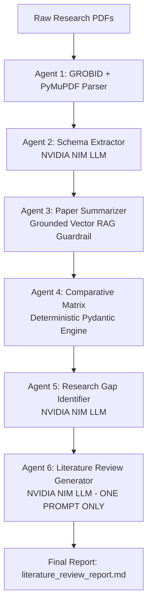

# Agentic AI for Automated Research Paper Analysis and Literature Review (NLP-05)

[](https://www.python.org/downloads/)
[](https://github.com/kermitt2/grobid)
[-76B900.svg)](https://build.nvidia.com)
[](https://opensource.org/licenses/MIT)

An autonomous multi-agent system designed to automate multi-paper literature synthesis, deep semantic schema extraction, cross-paper comparative matrix generation, research gap identification, and publication-ready survey drafting.

- **Project ID:** NLP-05 (NLP Interest Group, AY: 2026-27)
- **Institution:** Department of Computer Science and Engineering, R.V. College of Engineering
- **Faculty Mentors:** Dr. Sagar B M (Faculty Mentor) | Prof. Kavi Narayana Murthy | Dr. Chethana R Murthy

---

## 📖 How It Works (Multi-Agent Workflow)

The system transforms raw, unorganized academic PDFs into a coherent, structured literature review report through a specialized 6-agent pipeline:



1. **Agent 1: Academic Document Parser (`GROBID` + `PyMuPDF`)**
   - Connects to a local GROBID TEI-XML service to extract structured document hierarchy (`title`, `authors`, `abstract`, section heads, body text).
   - Concurrently uses PyMuPDF to extract visual assets: raster figures (`data/figures/{paper_id}/`) and detects vector charts/graphs through drawing path clustering.
   - Falls back gracefully to PyMuPDF reading-order blocks if GROBID service is unreachable.

2. **Agent 2: Semantic Schema Extraction (`extraction.py`)** *(LLM Call #1)*
   - Converts raw parsed sections into a strongly-typed Pydantic `PaperSchema`.
   - Extracts exact paper metadata, core problem statement, methodology, datasets, and explicit author-stated limitations.

3. **Agent 3: Single-Paper Summarizer (`summarizer.py`)** *(0 LLM Calls)*
   - Synthesizes multi-pillar summaries (problem motivation, technical innovations, empirical benchmarks, and constraints).
   - Operates via a grounded Vector RAG heuristic engine with strict zero-hallucination guardrails, without consuming LLM token quota.

4. **Agent 4: Cross-Paper Comparative Analysis (`comparative.py`)** *(0 LLM Calls)*
   - Compares all papers across standardized dimensions (problem domain, architectures, benchmark performance, trade-offs).
   - Generates a deterministic markdown comparison table via a Pydantic matrix engine, preventing JSON truncation errors.

5. **Agent 5: Research Gap Identification (`research_gap.py`)** *(LLM Call #2)*
   - Analyzes cross-paper limitations and maps out unexplored problem spaces.
   - Produces structured gaps categorized into *Explicit Author Limitations* and *Cross-Paper Synthesized Gaps*.

6. **Agent 6: Literature Review Report Generator (`report_generator.py`)** *(LLM Call #3 - ONE PROMPT ONLY)*
   - Fuses schema metadata, comparative tables, and research gaps into a comprehensive, publication-ready literature review draft.
   - Executes in **exactly one unified prompt** to minimize latency and token usage.

---

## ⚡ Architecture Evolution: Before vs. After

| Feature / Dimension | Legacy Architecture (Gemini Era) | Optimized Architecture (Current) |
| :--- | :--- | :--- |
| **LLM Provider** | Google Gemini 2.0 Flash / Pro | **NVIDIA NIM (`meta/muse-glimmer-30b`)** |
| **LLM Invocation Strategy** | Called at every stage (6+ calls per paper, 70+ calls per batch) | **Targeted 3-Point Budget** (Agent 2, Agent 5, Agent 6) |
| **Agent 3 (Summarizer)** | LLM API call per paper (frequent quota exhaustion) | **Grounded Vector RAG Engine** (0 LLM calls) |
| **Agent 4 (Comparative)** | LLM attempted massive 12-paper JSON (exceeded token limits, caused JSON parse crashes) | **Deterministic Pydantic Matrix Engine** (0 LLM calls, reliable & instant) |
| **Agent 6 (Report Gen)** | Multi-turn piecemeal generation | **Single Synthesis Prompt (`[ONE PROMPT ONLY]`)** |
| **PDF Parsing** | Basic `pypdf` text dumping (lost layouts, missed tables/figures) | **GROBID TEI-XML + PyMuPDF** (preserves academic sections + figures + graphs) |
| **Resilience & Cost** | Fragile to rate limits and API deprecations | Extremely fast, token-efficient, robust offline fallbacks |

---

## 🛠️ Requirements & Setup

### Prerequisites
- Python 3.10 or higher
- [Docker Desktop](https://www.docker.com/) (recommended for running GROBID)
- NVIDIA NIM API Key ([Get free key here](https://build.nvidia.com))

### 1. Clone & Install Dependencies
```bash
git clone https://github.com/Chaitanya-G41/Agentic-AI-for-literature-review.git
cd Agentic-AI-for-literature-review

# Create and activate virtual environment
python -m venv venv
venv\Scripts\activate      # Windows
# source venv/bin/activate # Linux/macOS

# Install dependencies
pip install -r requirements.txt
```

### 2. Configure Environment Variables
Create a `.env` file in the project root:
```ini
NVIDIA_API_KEY=nvapi-your-key-here
```

### 3. Start GROBID Service (Recommended for high-accuracy parsing)
Run GROBID via Docker in a separate terminal:
```bash
docker run -t --rm -p 8070:8070 lfoppiano/grobid:0.8.1
```
*Note: If GROBID is not running, the pipeline automatically falls back to PyMuPDF native block extraction.*

---

## 🚀 Running the Project

### Command-Line Live Demo (Full Pipeline)
Runs the entire 6-agent workflow over benchmark papers:
```bash
python demo.py
```
Outputs generated:
- Parsed JSONs & schemas: `data/extracted_schemas/`
- Paper figures: `data/figures/{paper_id}/`
- Structured summaries: `data/summaries/`
- Cross-paper comparison: `data/comparative_analysis.json`
- Final Literature Review: `data/reports/literature_review_report.md`

### Web Dashboard (Streamlit)
```bash
streamlit run app.py
```

---

## 📌 Pending Work & Roadmap (For Team Members)

The core multi-agent backend is fully stabilized and working. The following tasks are prioritized for the next sprint:

### 1. Visual Graphs & Mindmaps Integration (`Mermaid.js`)
- [ ] Embed interactive `Mermaid.js` diagrams in the web interface and generated reports.
- [ ] Automatically render concept mindmaps, taxonomy trees, and agent interaction sequence diagrams based on `comparative_analysis.json` and `ResearchGapAnalysis`.

### 2. Modern & Appealing Web UI
- [ ] Overhaul `app.py` into a modern, responsive dashboard (or lightweight Next.js/React frontend with FastAPI).
- [ ] Include paper card previews, real-time agent execution steppers, interactive metric comparison tables, and visual figure galleries.

### 3. Click-to-Paper Provenance Deep-Linking (Zero Hallucination Verification)
- [ ] When a user clicks any finding, metric, or limitation in the summary or comparison table, open the source paper in an integrated PDF viewer.
- [ ] Automatically highlight the exact bounding box or sentence where the information originated to guarantee grounded authenticity.

### 4. Dual Ingestion Mode (Custom Upload + arXiv Search Integration)
- [ ] Integrate the `arxiv` API search engine: users can type a research topic (e.g., *"LLM Multi-Agent Coordination"*), select papers, and fetch them automatically.
- [ ] Support drag-and-drop custom PDF uploads for any arbitrary research domain alongside benchmark papers.

---

## 📂 Repository Structure

```
Agentic-AI-for-literature-review/
├── README.md                  # Comprehensive documentation
├── requirements.txt           # Python package requirements
├── .env                       # API credentials (NVIDIA_API_KEY)
├── demo.py                    # Standalone multi-agent CLI runner
├── app.py                     # Interactive Streamlit UI
├── data/
│   ├── pdf_corpus/            # Benchmark input research PDFs
│   ├── figures/               # Extracted raster images & graphs
│   ├── extracted_schemas/     # Agent 2 validated Pydantic JSONs
│   ├── summaries/             # Agent 3 multi-pillar summary files
│   ├── comparative_analysis.json # Agent 4 structured matrix
│   └── reports/               # Agent 6 finalized literature review drafts
└── src/
    ├── ingestion/
    │   ├── downloader.py      # arXiv benchmark downloader
    │   ├── grobid_parser.py   # GROBID TEI-XML client
    │   └── parser.py          # GROBID + PyMuPDF layout & visual engine
    └── agents/
        ├── llm_manager.py     # NVIDIA NIM OpenAI-compatible LLM router
        ├── extraction.py      # Agent 2: Pydantic schema extractor
        ├── summarizer.py      # Agent 3: Grounded Vector RAG summarizer
        ├── comparative.py     # Agent 4: Deterministic matrix comparator
        ├── research_gap.py    # Agent 5: Research gap identification
        └── report_generator.py# Agent 6: One-prompt final report synthesis
```

---

## 📄 License & Credits
Developed under the **NLP Interest Group (NLP-05)** at **R.V. College of Engineering**.  
Released under the [MIT License](LICENSE).
