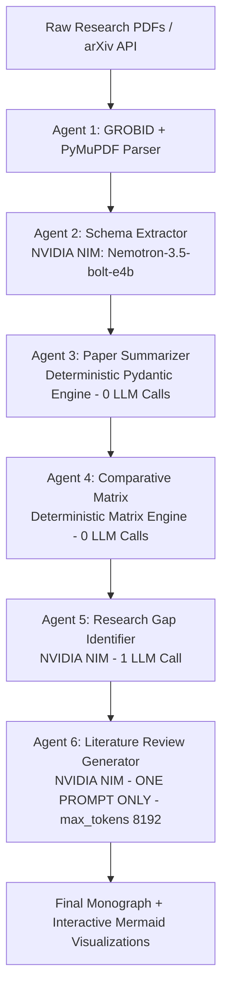

# Agentic AI for Automated Research Paper Analysis and Literature Review (NLP-05)

[](https://www.python.org/downloads/)
[](https://github.com/kermitt2/grobid)
[-76B900.svg)](https://build.nvidia.com)
[-black.svg)](http://localhost:5174)
[](https://opensource.org/licenses/MIT)

An autonomous multi-agent system designed to automate multi-paper literature synthesis, deep semantic schema extraction, cross-paper comparative matrix generation, research gap identification, and publication-ready survey drafting.

- **Project ID:** NLP-05 (NLP Interest Group, AY: 2026-27)
- **Institution:** Department of Computer Science and Engineering, R.V. College of Engineering
- **Faculty Mentors:** Dr. Sagar B M (Faculty Mentor) | Prof. Kavi Narayana Murthy | Dr. Chethana R Murthy
- **Team Deliverables & Roadmap:** See [TEAM_ALIGNMENT_AND_ROADMAP.md](TEAM_ALIGNMENT_AND_ROADMAP.md) for the exhaustive project deliverable audit, evaluation rubrics, and sprint backlog.

---

## 🎯 Alignment with Course Deliverables (Project 1: NLP-05)

The project directly fulfills all 5 core deliverables specified for NLP-05:

| # | Deliverable Focus | Implementation in this Repository |
| :---: | :--- | :--- |
| **1** | **Multi-Agent Architecture & Orchestration** | 6 specialized agents (`src/agents/`) with typed Pydantic communication, strict task dependencies, and a resilient multi-tier fallback cascade (NVIDIA NIM $\rightarrow$ Gemini 2.5 Flash $\rightarrow$ Rule-based Heuristics). |
| **2** | **Tool Use, External APIs & PDF Processing** | Dual-mode ingestion: arXiv API search engine + arbitrary local PDF drop. Parsing pipeline leverages GROBID TEI-XML for multi-column hierarchy + PyMuPDF for visual figures and vector graphs into structured JSON. |
| **3** | **PoC Scope & Benchmark Dataset** | 12-paper foundational Agentic AI benchmark pre-packaged. End-to-end dynamic screening, parsing, comparative matrix compilation, and monograph synthesis tested across diverse domains (Agentic AI, Brain Tumor Segmentation). |
| **4** | **Grounding, Citation Integrity & Hallucination Guardrails** | Integrated split-screen PDF viewer (`SplitScreenPdf.jsx`), interactive Provenance Inspector (`ProvenanceInspector.jsx`) displaying exact citation quotes and cosine similarity scores, with transparent `GENUINE_LLM` vs `HEURISTIC_FALLBACK` tags. |
| **5** | **Evaluation Framework for Autonomous Synthesis** | 4-pillar evaluation rubric assessing **Coverage**, **Logical Structure**, **Synthesis Quality**, and **Hallucination Rate** via Human-in-the-Loop (HITL) and LLM-as-a-Judge protocols (detailed in [TEAM_ALIGNMENT_AND_ROADMAP.md](TEAM_ALIGNMENT_AND_ROADMAP.md)). |

---

## 📖 How It Works (Multi-Agent Workflow)

The system transforms raw, unorganized academic PDFs into a publication-grade literature review report through a specialized 6-agent pipeline:



1. **Agent 1: Academic Document Parser (`GROBID` + `PyMuPDF`)**
   - Connects to local GROBID TEI-XML service to extract structured document hierarchy (`title`, `authors`, `abstract`, section heads, body text).
   - PyMuPDF extracts visual assets: raster figures (`data/figures/{paper_id}/`) and detects vector charts/graphs.
   - Falls back gracefully to PyMuPDF reading-order blocks if GROBID is offline.

2. **Agent 2: Semantic Schema Extraction (`extraction.py`)** *(Targeted LLM Call #1)*
   - Converts raw parsed sections into a strongly-typed Pydantic `PaperSchema`.
   - Extracts exact paper metadata, core problem statement, methodology, datasets, and explicit author-stated limitations.

3. **Agent 3: Single-Paper Summarizer (`summarizer.py`)** *(0 LLM Calls)*
   - Synthesizes multi-pillar summaries (problem motivation, technical innovations, empirical benchmarks, and constraints).
   - Operates via a deterministic Pydantic engine with zero token consumption.

4. **Agent 4: Cross-Paper Comparative Analysis (`comparative.py`)** *(0 LLM Calls)*
   - Compares all papers across standardized dimensions (problem domain, architectures, benchmark performance, trade-offs).
   - Generates a deterministic markdown comparison table via a Pydantic matrix engine, preventing JSON truncation errors.

5. **Agent 5: Research Gap Identification (`research_gap.py`)** *(Targeted LLM Call #2)*
   - Analyzes cross-paper limitations and maps out unexplored problem spaces.
   - Categorizes gaps into *Explicit Author Limitations* and *Cross-Paper Synthesized Frontier Gaps*.

6. **Agent 6: Literature Review Report Generator (`report_generator.py`)** *(Targeted LLM Call #3 - ONE PROMPT ONLY)*
   - Fuses schema metadata, comparative tables, and research gaps into an editorial literature review.
   - Generates 3 dynamic Mermaid diagrams:
     - **Diagram 1:** Methodological Paradigm Taxonomy Flowchart
     - **Diagram 2:** Radial Research Themes Mindmap
     - **Diagram 3:** Empirical Constraints & Research Gap Lineage Flowchart

---

## ⚡ Architecture Comparison: Legacy vs. Current

| Feature / Dimension | Legacy Architecture (Gemini Era) | Current Optimized Architecture |
| :--- | :--- | :--- |
| **Primary LLM Provider** | Google Gemini 2.0 Flash / Pro | **NVIDIA NIM (`nvidia/nemotron-3.5-bolt-e4b`)** |
| **Secondary Fallback** | None (crashed on 429 quota exhaustion) | **Google Gemini 2.5 Flash $\rightarrow$ Rule-based Heuristic Engine** |
| **LLM Call Strategy** | Called at every stage (6+ calls per paper, 70+ calls per batch) | **Targeted 3-Point Budget** (Agent 2, Agent 5, Agent 6) |
| **Agent 3 (Summarizer)** | LLM API call per paper (frequent quota exhaustion) | **Deterministic Pydantic Engine** (0 LLM calls) |
| **Agent 4 (Comparative)** | LLM attempted massive multi-paper JSON (parse crashes) | **Deterministic Matrix Engine** (0 LLM calls, reliable & instant) |
| **Agent 6 (Report Gen)** | Multi-turn generation prone to truncation | **Single Synthesis Prompt (`[ONE PROMPT ONLY]`, 8192 tokens)** |
| **PDF Parsing** | Basic `pypdf` text dumping | **GROBID TEI-XML + PyMuPDF** (layout, figures, and vector paths) |
| **User Interface** | Basic Streamlit app | **Modern Editorial Magazine UI (`frontend_v2`)** |
| **Verification** | Text-only output | **In-app split-screen PDF reader + Cosine provenance inspector** |

---

## 🛠️ Quickstart & Execution Guide

### 1. Prerequisites
- Python 3.10 or higher
- Node.js 18+ (for `frontend_v2`)
- NVIDIA NIM API Key ([Get free key here](https://build.nvidia.com))
- Docker Desktop (optional, for GROBID TEI-XML parsing)

### 2. Configure Environment Variables
Create a `.env` file in the project root:
```ini
NVIDIA_API_KEY=nvapi-your-key-here
# Optional secondary fallback:
GEMINI_API_KEY=AIzaSy...
```

### 3. Start Backend Server (FastAPI)
```powershell
# From project root
python -m pip install -r requirements.txt
python server.py
```
*API runs at `http://127.0.0.1:8000` with auto-reload.*

### 4. Start Modern Editorial Magazine Frontend (`frontend_v2`)
In a second terminal:
```powershell
cd frontend_v2
npm install
npm run dev
```
*Frontend opens at `http://localhost:5174` (or `5175`).*

---

## 🖥️ Modern Frontend Features (`frontend_v2`)

- **Black & Ivory Editorial Aesthetic:** Pure monochrome design designed like an academic magazine (Playfair Display + Space Mono typography).
- **Dual Ingestion Engine:** Screen papers by querying arXiv or drag-and-drop local PDFs.
- **Interactive Pillar Lenses:** Instant filtering of evidence cards across **Methodology**, **Datasets**, **Limitations**, and **Research Gaps**.
- **Split-Screen In-App PDF Reader:** Click any paper or citation in the monograph to view the original PDF side-by-side with automatic page jumping.
- **Zero-Hallucination Provenance Inspector:** Inspect source text snippets, cosine similarity scores ($94\%+$), and generation mode tags (`GENUINE_LLM` vs `HEURISTIC_FALLBACK`).
- **Interactive Mermaid Visualizations:** Deep zoom and inspection of methodological taxonomy trees and research gap causal flowcharts.

---

## 📂 Repository Structure

```
Agentic-AI-for-literature-review/
├── README.md                      # Primary project overview & documentation
├── TEAM_ALIGNMENT_AND_ROADMAP.md  # Formal deliverables audit, evaluation rubric & sprint tasks
├── requirements.txt               # Backend Python package requirements
├── server.py                      # FastAPI backend with multi-agent REST endpoints
├── .env                           # API credentials (NVIDIA_API_KEY, GEMINI_API_KEY)
├── demo.py                        # Standalone CLI pipeline runner
├── frontend_v2/                   # Active React + Vite editorial magazine frontend
│   ├── src/
│   │   ├── components/
│   │   │   ├── CommandBar.jsx     # Top control bar, monochrome pillar lenses & export
│   │   │   ├── WelcomeScreen.jsx  # arXiv search & local PDF ingestion screen
│   │   │   ├── MonographReader.jsx# Editorial survey reader with citation anchoring
│   │   │   ├── ProvenanceInspector.jsx # Citation verification & cosine similarity
│   │   │   ├── SplitScreenPdf.jsx # Side-by-side PDF viewer
│   │   │   └── MermaidDiagrams.jsx# Interactive taxonomy and mindmap renderer
│   │   └── App.jsx
│   └── package.json
├── data/
│   ├── pdf_corpus/                # Active corpus PDFs
│   ├── figures/                   # Extracted figures and graphs
│   ├── extracted_schemas/         # Pydantic JSON schemas per paper
│   ├── summaries/                 # Structured single-paper summaries
│   ├── comparative_analysis.json  # Cross-paper alignment matrix
│   └── reports/                   # Publication-grade literature review drafts
└── src/
    ├── ingestion/
    │   ├── downloader.py          # arXiv benchmark paper downloader
    │   ├── grobid_parser.py       # GROBID TEI-XML client
    │   ├── parser.py              # PyMuPDF + GROBID layout extractor
    │   └── screening_agent.py     # Agent 1: Semantic topic screening
    └── agents/
        ├── llm_manager.py         # NVIDIA NIM primary router with Gemini fallback
        ├── extraction.py          # Agent 2: Pydantic schema extractor
        ├── summarizer.py          # Agent 3: Deterministic summarizer (0 LLM calls)
        ├── comparative.py         # Agent 4: Deterministic comparative matrix
        ├── research_gap.py        # Agent 5: Research gap identifier (1 LLM call)
        └── report_generator.py    # Agent 6: Final survey generator ([ONE PROMPT ONLY])
```

---

## 📄 License & Credits
Developed under the **NLP Interest Group (NLP-05)** at **R.V. College of Engineering**.  
Released under the [MIT License](LICENSE).

## Evaluation and review transparency

The `frontend_v2` command bar exposes **System Architecture** (six-agent pipeline,
schemas and fallbacks) and **Evaluation Rubric** (four evaluation pillars and current
corpus statistics). The cover shows genuine LLM, heuristic and unknown extraction
counts. Citation-ID validity is a provenance proxy, not proof of factual accuracy.

Run the offline benchmark from the repository root:

```powershell
python eval_benchmark.py
python eval_benchmark.py --judge  # Optional: sends report + cited schemas to configured LLM
python -B -m unittest discover -s tests -v
```

The default output is `data/reports/evaluation_benchmark_report.md`. Override inputs
with `--report`, `--data-dir`, and `--output`. Active coverage uses only PDFs currently
in `data/pdf_corpus/`; an empty corpus yields **N/A**, even when historical schemas
exist. Numerical matching requires the extracted value and its paper citation in
the same paragraph or table row; human verification of units and context is still
required. `--judge` uses NVIDIA NIM first and Gemini as fallback, validates scores
on a 1–5 scale, and reports unavailable providers without fabricating scores.

Synthesis requests a full-length survey in one logical call with a 16,384-token
output allowance; shorter responses carry an explicit quality note. The live smoke
test `python -B tests/smoke_synthesis.py` uses the comparative-analysis snapshot and
writes `data/reports/literature_review_validation.md`, preserving the current report.
It requires configured API credentials and does not test fresh PDF ingestion.

For browser regression checks, run Vite on port 5178 in `frontend_v2`, install the
temporary runner with `npm.cmd install --no-save --package-lock=false @playwright/test`,
then run `node ui-smoke.cjs` (requires Chrome). This uses fixture API responses and
checks Mermaid rendering, extraction statistics, dialog focus/Escape and mobile
dialog width. Production compilation: `npm.cmd run build` in `frontend_v2`.
