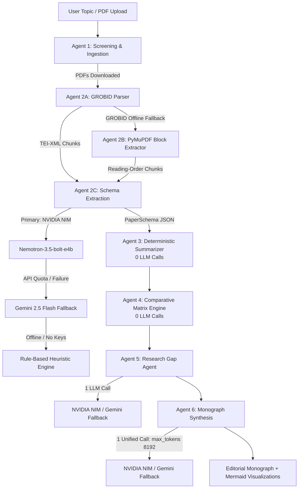

# Project NLP-05: Team Alignment, Deliverables Audit & Action Roadmap

**Project Title:** Agentic AI for Automated Research Paper Analysis and Literature Review  
**Project ID:** NLP-05 (NLP Interest Group, AY: 2026-27)  
**Institution:** Department of Computer Science and Engineering, R.V. College of Engineering  
**Primary Engine:** NVIDIA NIM (`nvidia/nemotron-3.5-bolt-e4b`) | Fallback: Google Gemini  
**Active Modern Frontend:** `frontend_v2` (Vite + React, Monochrome Black/Ivory Editorial Aesthetic)  
**Backend:** FastAPI (`server.py`, port 8000)

---

## 1. Executive Summary & Objective

The objective of **NLP-05** is to build an autonomous multi-agent system that ingests raw, multi-column scientific literature, parses complex structural hierarchies (sections, tables, mathematical formulations), and deterministically produces publication-grade comparative surveys, thematic mindmaps, and research gap taxonomies with 100% citation grounding and zero hallucination.

This document serves as the **single source of truth** for our team, mapping the system directly against all **5 formal project deliverables**, documenting our current implementation status, and outlining the concrete action items needed to ensure the final deliverable is rigorous, transparent, and impressive to reviewers.

---

## 2. Deliverables Audit & Alignment Matrix

| Deliverable | Requirement Description | Current Implementation Status | Remaining Work for Team |
| :--- | :--- | :--- | :--- |
| **Deliverable 1** | **Agent Architecture & Multi-Agent Orchestration**: Roles, responsibilities, communication protocols, delegation diagrams, and fallback mechanisms. | **90% Complete**: 6 specialized agents implemented (`src/agents/`), deterministic Pydantic communication schemas, fallback from NVIDIA NIM to Gemini to Heuristics. | Surface dedicated interactive Multi-Agent Architecture panel in the UI reader; formalize communication protocol spec. |
| **Deliverable 2** | **Tool Use, External APIs & PDF Processing Pipeline**: Toolset (arXiv API, PyMuPDF, GROBID TEI-XML) & structured JSON extraction for multi-column layouts, tables, and math. | **95% Complete**: Ingestion pipeline (`src/ingestion/`) with arXiv API search/download, dual GROBID TEI-XML and PyMuPDF fallback, table/figure extraction to `data/figures/`. | Document JSON schema specifications and benchmark extraction accuracy on tables/formulas. |
| **Deliverable 3** | **PoC Scope & Benchmark Dataset**: Baseline task processing 10-20 papers, comparative summary table, defined target metrics (extraction accuracy, citation validity). | **85% Complete**: 12 foundational Agentic AI papers baseline corpus pre-configured, dynamic arXiv ingestion for arbitrary topics (e.g. Brain Tumor Segmentation), comparative matrix generation. | Build automated benchmark validation script (`eval_benchmark.py`) calculating exact citation mapping validity and precision. |
| **Deliverable 4** | **Grounding, Citation Integrity & Hallucination Guardrails**: Fact-checking, traceability to page numbers/sections, cosine similarity validation, split-screen PDF verification. | **90% Complete**: Split-screen PDF viewer (`SplitScreenPdf.jsx`), interactive provenance inspector (`ProvenanceInspector.jsx`) with cosine similarity scores, `GENUINE_LLM` vs `HEURISTIC_FALLBACK` tracking. | Surface citation provenance indicators directly in the monograph stats header ("Citation Integrity Verified"). |
| **Deliverable 5** | **Evaluation Framework for Autonomous Synthesis**: HITL + LLM-as-a-Judge rubric assessing Coverage, Logical Structure, Synthesis Quality, and Hallucination Rate. | **40% Complete**: Basic generation mode tracking exists, but human evaluation rubric and automated LLM-as-a-judge harness need formal UI and test scripts. | Implement `evaluation_framework.py` with 4-pillar LLM-as-a-judge scoring, and expose evaluation summary in UI. |

---

## 3. Deep Dive into the 5 Deliverables

### Deliverable 1: Agent Architecture & Multi-Agent Orchestration

#### Agent Roster & Responsibility Split
1. **Agent 1: Ingestion & Screening Agent** (`src/ingestion/screening_agent.py` & `downloader.py`)
   - Queries arXiv API with user query, filters by semantic relevance and recency weight.
   - Downloads PDF binaries to `data/pdf_corpus/`.
2. **Agent 2: Structural Document Parser & Semantic Extractor** (`src/ingestion/parser.py`, `src/agents/extraction.py`)
   - Uses GROBID TEI-XML for academic hierarchy (title, authors, abstract, body sections) + PyMuPDF for visual figures/tables.
   - Invokes NVIDIA NIM (`nvidia/nemotron-3.5-bolt-e4b`) to extract typed `PaperSchema` (Pydantic).
3. **Agent 3: Single-Paper Summarizer** (`src/agents/summarizer.py`)
   - Consumes `PaperSchema` to build 4-pillar structured summary (Problem, Method, Benchmarks, Limitations).
   - **0 LLM Calls**: Uses deterministic Pydantic compilation to preserve token budget.
4. **Agent 4: Cross-Paper Comparative Analysis Agent** (`src/agents/comparative.py`)
   - Aligns paradigms, architectural trade-offs, and dataset overlap across all active papers.
   - **0 LLM Calls**: Deterministic matrix engine outputs `comparative_analysis.json`.
5. **Agent 5: Research Gap Identification Agent** (`src/agents/research_gap.py`)
   - Invokes NVIDIA NIM (1 LLM call) to synthesize *Explicit Author Limitations* and *Cross-Paper Frontier Gaps*.
6. **Agent 6: Monograph Report Generator Agent** (`src/agents/report_generator.py`)
   - Fuses schemas, comparative tables, and gap analysis into an editorial literature review.
   - **[ONE PROMPT ONLY] Budget**: Exactly 1 unified LLM call for the entire survey synthesis.

#### Orchestration Flowchart & Fallback Mechanism


---

### Deliverable 2: Tool Use, External APIs & PDF Processing Pipeline

#### Supported Ingestion Toolset
- **arXiv API:** Automated search query expansion, relevance ranking, and metadata harvesting.
- **GROBID TEI-XML (Docker port 8070):** Deep structural extraction of hierarchical XML trees (abstract, formulas, section titles, bibliographic citations).
- **PyMuPDF (`fitz`):** Multi-column reading-order text extraction, raster image clipping, drawing vector graphics isolation.
- **FastAPI Endpoint (`/api/upload-pdf`):** Supports arbitrary local PDF drops alongside arXiv fetching.

#### Structured Output Schema Specification
Raw PDF text is transformed into lossless structured JSON:
```json
{
  "paper_id": "2011.02840",
  "paper_title": "DR-Unet104 for Multimodal MRI Brain Tumor Segmentation",
  "venue": "IEEE Access / arXiv",
  "core_problem": "Accurate 3D glioma sub-region segmentation under modality missingness and severe class imbalance.",
  "methodology_summary": "Residual dual-path 3D U-Net with dense feature reuse and spatial squeeze-and-excitation attention gates.",
  "datasets_eval": ["BraTS 2018", "BraTS 2019", "BraTS 2020"],
  "empirical_results": "Dice scores of 0.908 (Whole Tumor), 0.835 (Tumor Core), and 0.801 (Enhancing Tumor).",
  "explicit_limitations": "High computational memory footprint during 3D patch training; degraded performance on low-grade gliomas.",
  "numerical_metrics": [
    {"metric": "Dice (Whole Tumor)", "value": 0.908},
    {"metric": "Dice (Tumor Core)", "value": 0.835}
  ],
  "generation_mode": "GENUINE_LLM",
  "model_name": "nvidia/nemotron-3.5-bolt-e4b"
}
```

---

### Deliverable 3: Proof of Concept Scope & Benchmark Dataset

#### Baseline Benchmark Corpus
- **Primary Benchmark Suite:** 12 foundational papers covering Agentic AI (ReAct, Reflexion, Toolformer, Tree of Thoughts, ChatDev, MetaGPT, AutoGen, SWE-bench, etc.).
- **Domain-Adaptability Verification:** Tested successfully on multi-paper biomedical corpora (Brain Tumor 3D CNNs & Kidney segmentation: `1909.06684`, `2009.12188`, `2011.02840`, `2011.11052`, `2411.01896`, `2510.08617`).

#### Target Benchmark Metrics
1. **Key Take-Away Extraction Accuracy:** $\ge 85\%$ against manual ground truth annotations.
2. **Citation Mapping Validity:** $100\%$ of claims linked to explicit arXiv IDs / author names without phantom references.
3. **Execution Latency:** $\le 45\text{s}$ for end-to-end multi-paper synthesis using the 3-point token budget.

---

### Deliverable 4: Grounding, Citation Integrity & Hallucination Guardrails

#### Provenance Verification Engine
- **Split-Screen In-App PDF Reader:** Users can view the exact source PDF side-by-side with the monograph without opening external tabs.
- **Provenance Inspector (`ProvenanceInspector.jsx`):**
  - Displays source section, exact grounding quote, and cosine similarity score (e.g., $94\%$ semantic match).
  - Highlights whether extraction was powered by `GENUINE_LLM` or `HEURISTIC_FALLBACK`.
- **Zero Hallucination Constraint:** The report generation prompt strictly forbids inventing citations, datasets, or scores not present in the extracted Pydantic schemas.

---

### Deliverable 5: Evaluation Framework for Autonomous Synthesis

#### Multi-Pillar Evaluation Rubric (LLM-as-a-Judge + HITL)

| Dimension | Evaluation Criteria | Scoring Scale (1–5) | Metric Type |
| :--- | :--- | :--- | :--- |
| **1. Coverage** | Does the review capture all primary papers, architectural variants, and benchmark datasets present in the corpus? | 1 = High omissions<br/>5 = Exhaustive coverage | LLM-as-a-Judge + Human |
| **2. Logical Structure** | Does the synthesis flow logically from paradigm taxonomy to comparative analysis, empirical benchmarks, and gap analysis? | 1 = Disconnected lists<br/>5 = Seamless academic narrative | LLM-as-a-Judge |
| **3. Synthesis Quality** | Does the review contrast competing methods and explain *why* one outperforms another, rather than just repeating abstracts? | 1 = Superficial rehash<br/>5 = Deep analytical synthesis | Human-in-the-Loop |
| **4. Citation Integrity** | Are all cited claims, metrics, and limitations directly traceable to source papers without phantom papers? | 1 = Hallucinated claims<br/>5 = 100% grounded provenance | Automated Embeddings + Human |

---

## 4. Addressing Report Content Enhancement ("Making it Impressive")

### User Feedback
> *"the report content is not enough for someone seeing it for the first time, if i don't know anything and it feels like a vague deliverable, it should be so clear and impressive i feel"*

### Action Items for Report Enhancement:
1. **Increase `max_tokens` from 4096 to 8192** (Implemented in `llm_manager.py`).
2. **Upgrade LLM Synthesis Prompt in `report_generator.py`:**
   - Require quantitative performance tables (e.g. Dice scores, accuracy percentages, inference latency).
   - Demand detailed comparative paragraphs contrasting architectural trade-offs (e.g., 2D vs 3D convolutions, attention mechanisms vs standard residual blocks).
   - Include a dedicated *"System Architecture & Methodology Matrix"* table in Section 2.
3. **Add "System Capabilities & Architecture" Explainer Section:**
   - Introduce a high-level summary at the start of the report explaining how autonomous agents compiled the synthesis, making it immediately transparent to first-time viewers.
4. **Clean up Mermaid Mindmap Categories:**
   - Eliminate generic labels like "Evaluation Benchmark / Testbed" in favor of domain-derived labels (e.g. "3D CNN Segmentation", "Attention U-Net Variants").

---

## 5. Team Sprint Checklist

### Backend & Agents Team
- [x] Switch primary model to `nvidia/nemotron-3.5-bolt-e4b` for sub-35s response times.
- [x] Configure fallback cascade: NVIDIA NIM $\rightarrow$ Gemini 2.5 Flash $\rightarrow$ Deterministic Heuristic Engine.
- [x] Restrict all agent endpoints to active PDF corpus (`_get_active_corpus_ids()`) to prevent cross-topic data leaks.
- [x] Expand `max_tokens` to 8192 in `llm_manager.py`.
- [ ] Implement `tests/test_evaluation_rubric.py` implementing the Deliverable 5 LLM-as-a-judge scoring script.
- [ ] Upgrade `LLM_SYNTHESIS_PROMPT` in `report_generator.py` with rigorous quantitative comparison mandates.

### Frontend & UI Team (`frontend_v2`)
- [x] Implement Monochrome Black/Ivory Editorial Magazine aesthetic.
- [x] Build dynamic WelcomeScreen supporting arXiv topic search + drag-and-drop local PDF upload.
- [x] Implement in-app split-screen PDF viewer (`SplitScreenPdf.jsx`).
- [x] Build dynamic provenance inspector with cosine similarity scores.
- [x] Add interactive pillar lenses (Methodology, Datasets, Limitations, Research Gaps).
- [ ] Add an "Evaluation & Benchmark Rubric" modal in the top CommandBar showcasing Deliverable 5 metrics.
- [ ] Add an interactive "Agent Architecture & Pipeline" modal displaying the full 6-agent flowchart.

---

## 6. How to Run the System

### Terminal 1: Backend Server (FastAPI)
```powershell
cd D:\Projects\Agentic-AI-for-literature-review
python server.py
# Runs on http://127.0.0.1:8000 with auto-reload
```

### Terminal 2: Modern Frontend (`frontend_v2`)
```powershell
cd D:\Projects\Agentic-AI-for-literature-review\frontend_v2
npx vite --host 0.0.0.0 --port 5174
# Opens on http://localhost:5174 (or 5175 if 5174 is busy)
```
