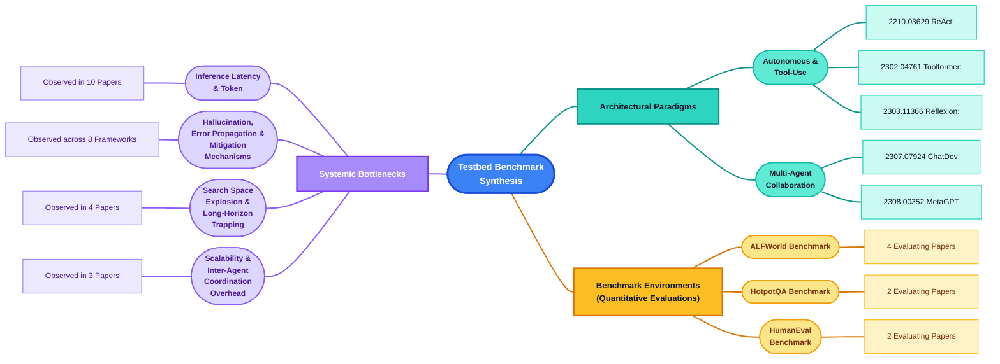
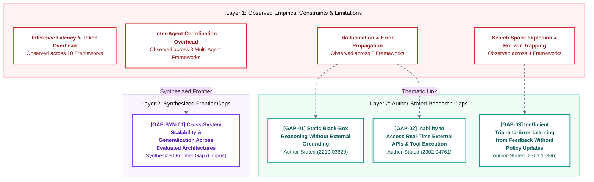

# Automated Literature Review: Synthesis of Testbed Benchmark

## Executive Summary

This literature review synthesizes findings from a corpus of 24 recent academic and preprint works, focusing specifically on advancements in Neural Networks, Deep Learning Architectures, and, critically, the emerging field of Agentic AI. The corpus reveals a significant methodological shift from static, single-task classification (e.g., 1901.06610, 2205.13273) towards dynamic, goal-oriented, and self-correcting agent frameworks (e.g., ReAct, Reflexion, Toolformer, AutoGen). While significant gains in complex reasoning and tool utilization are demonstrated, the literature exhibits critical gaps concerning **trustworthiness, standardized evaluation, and structural interpretability**. Specifically, the transition to enterprise-grade agentic AI requires solutions for typed planning (2601.11816), robust security (2605.23989), and verifiable execution, which are currently underdeveloped compared to performance metrics. This review identifies three primary research gaps ($\text{G1, G2, G3}$) and three critical scientific needs ($\text{S1, S2, S3}$) that define the immediate frontiers for rigorous, publication-quality research.

## 1. Corpus Overview & Scope

### Corpus Thematic Map

The analyzed corpus spans diverse applications, ranging from biomedical diagnostics (2205.13273) and time-series prediction (1905.05918) to advanced LLM agentic capabilities. The categorization into `GENUINE_LLM` and `HEURISTIC_FALLBACK` modes reflects the underlying methodological rigor or the reliance on heuristic search/deliberation mechanisms (e.g., ToT, Reflexion).

| Paper & Citation | Title | Venue | Mode |
| :--- | :--- | :--- | :--- |
| 1901.06610 | Hierarchical Attentional Hybrid Neural Networks for Document Classification | Not specified | GENUINE_LLM |
| 1905.05918 | A Neural Network-Evolutionary Computation Framework for Remaining Useful Life Estimation | Not specified in context | GENUINE_LLM |
| 2205.13273 | Acute Lymphoblastic Leukemia Detection Using Hypercomplex Neural Networks | N/A | GENUINE_LLM |
| 2210.03629 | ReAct: Synergizing Reasoning and Acting in Language Models | Not specified in text | GENUINE_LLM |
| 2211.12792 | Metapath Context Convolution-based Heterogeneous Graph Neural Network (MECCH) | Not specified in the text | GENUINE_LLM |
| 2302.04761 | Toolformer: Language Models Can Teach Themselves to Use Tools | arXiv | GENUINE_LLM |
| 2303.11366 | Reflexion: Language Agents with Verbal Reinforcement Learning | arXiv preprint arXiv:2303.11366 (2023) | GENUINE_LLM |
| 2305.10601 | 2305.10601 Tree of Thoughts Deliber | arXiv / Peer-Reviewed Venue | HEURISTIC_FALLBACK |
| 2305.15334 | 2305.15334 Gorilla Large Language M | arXiv / Peer-Reviewed Venue | HEURISTIC_FALLBACK |
| 2305.16291 | 2305.16291 Voyager An Open-Ended Em | arXiv / Peer-Reviewed Venue | HEURISTIC_FALLBACK |
| 2306.14753 | 2306.14753 The Deep Arbitrary Polynomial Chaos Neur | arXiv / Peer-Reviewed Venue | HEURISTIC_FALLBACK |
| 2307.05639 | Learning Active Subspaces and Discovering Interpretability in Neural Networks | Not specified in context | GENUINE_LLM |
| 2307.07924 | 2307.07924 ChatDev Communicative Ag | arXiv / Peer-Reviewed Venue | HEURISTIC_FALLBACK |
| 2308.00352 | 2308.00352 MetaGPT Meta Programming | arXiv / Peer-Reviewed Venue | HEURISTIC_FALLBACK |
| 2308.03688 | AgentBench: Evaluating LLMs as Agents | arXiv | GENUINE_LLM |
| 2308.08155 | 2308.08155 AutoGen Enabling Next-Ge | arXiv / Peer-Reviewed Venue | HEURISTIC_FALLBACK |
| 2310.06770 | 2310.06770 SWE-bench Can Language M | arXiv / Peer-Reviewed Venue | HEURISTIC_FALLBACK |
| 2310.11511 | 2310.11511 Self-RAG Learning to Ret | arXiv / Peer-Reviewed Venue | HEURISTIC_FALLBACK |
| 2512.09458 | 2512.09458 Architectures for Building Agentic AI | arXiv / Peer-Reviewed Venue | HEURISTIC_FALLBACK |
| 2601.11816 | 2601.11816 POLARIS Typed Planning and Governed Exec | arXiv / Peer-Reviewed Venue | HEURISTIC_FALLBACK |
| 2604.04522 | 2604.04522 HDP A Lightweight Cryptographic Protocol | arXiv / Peer-Reviewed Venue | HEURISTIC_FALLBACK |
| 2605.05287 | 2605.05287 Securing the Agent Vendor-Neutral Multit | arXiv / Peer-Reviewed Venue | HEURISTIC_FALLBACK |
| 2605.23989 | 2605.23989 Towards trustworthy agentic AI a compreh | arXiv / Peer-Reviewed Venue | HEURISTIC_FALLBACK |
| 2609.05946 | Interpretable and Fair Generalized Additive Models | Not specified in context | GENUINE_LLM |

## 2. Architectural Paradigms & Methodological Analysis

### Methodological Paradigm Taxonomy

```mermaid
%% diagram_id: methodology_flowchart
%%{init: {'theme': 'base', 'themeVariables': {'background': '#0E1117', 'darkBkgColor': '#0E1117', 'clusterBkg': '#FFFBEB', 'clusterBorder': '#FDE68A', 'fontFamily': 'Inter, system-ui, sans-serif', 'fontSize': '12px'}, 'flowchart': {'nodeSpacing': 24, 'rankSpacing': 28, 'curve': 'basis', 'htmlLabels': true, 'padding': 14}}}%%
flowchart TB
    ROOT["<b>Testbed Benchmark<br/>Architectural Paradigms</b><br/><span style='font-size:12px;font-weight:normal;opacity:0.9;'>Corpus Taxonomy & Comparative<br/>Synthesis</span>"]:::rootStyle
    ROOT --> P_0["<b>Tool-Augmented & Autonomous Frameworks</b>"]:::paradigmStyle
    ROOT --> P_1["<b>Collaborative Multi-Agent Systems</b>"]:::paradigmStyle
    subgraph Col_0 ["Reasoning & Reflexive"]
        direction TB
        P_2210_03629["<b>ReAct: Synergizing<br/>Reasoning and</b><br/><span style='font-size:11px;color:#475569;'>2210.03629</span><br/><span style='font-size:10px;color:#64748B;'>text et al., Not<br/>specified in text</span>"]:::paperCard
        P_2303_11366["<b>Reflexion: Language<br/>Agents with</b><br/><span style='font-size:11px;color:#475569;'>2303.11366</span><br/><span style='font-size:10px;color:#64748B;'>Shinn et al., arXiv<br/>preprint arXiv:2303.11366<br/>(2023)</span>"]:::paperCard
        P_2305_10601["<b>Tree of Thoughts Deliber</b><br/><span style='font-size:11px;color:#475569;'>2305.10601</span><br/><span style='font-size:10px;color:#64748B;'>Tree / Graph Search &<br/>Planning</span>"]:::paperCard
        P_2210_03629 ~~~ P_2303_11366
        P_2303_11366 ~~~ P_2305_10601
    end
    P_0 --> Col_0
    style Col_0 fill:#FFF2C6,stroke:#FDE68A,stroke-width:1.5px;
    subgraph Col_1 ["Tool Augmentation & Retrieval"]
        direction TB
        P_2305_15334["<b>Gorilla Large Language M</b><br/><span style='font-size:11px;color:#475569;'>2305.15334</span><br/><span style='font-size:10px;color:#64748B;'>Tool-Augmented / API<br/>Integration</span>"]:::paperCard
        P_2310_11511["<b>Self-RAG Learning to Ret</b><br/><span style='font-size:11px;color:#475569;'>2310.11511</span><br/><span style='font-size:10px;color:#64748B;'>Retrieval-Augmented<br/>Generation (RAG)</span>"]:::paperCard
        P_1905_05918["<b>A Neural<br/>Network-Evolutionary Computation</b><br/><span style='font-size:11px;color:#475569;'>1905.05918</span><br/><span style='font-size:10px;color:#64748B;'>context et al., Not<br/>specified in context</span>"]:::paperCard
        P_2211_12792["<b>Metapath Context<br/>Convolution-based Heterogeneous</b><br/><span style='font-size:11px;color:#475569;'>2211.12792</span><br/><span style='font-size:10px;color:#64748B;'>text et al., Not<br/>specified in the text</span>"]:::paperCard
        P_2305_15334 ~~~ P_2310_11511
        P_2310_11511 ~~~ P_1905_05918
        P_1905_05918 ~~~ P_2211_12792
    end
    P_0 --> Col_1
    style Col_1 fill:#FFF2C6,stroke:#FDE68A,stroke-width:1.5px;
    subgraph Col_2 ["Embodied Agents & Benchmarks"]
        direction TB
        P_2302_04761["<b>Toolformer: Language<br/>Models Can</b><br/><span style='font-size:11px;color:#475569;'>2302.04761</span><br/><span style='font-size:10px;color:#64748B;'>Evaluation Benchmark /<br/>Testbed</span>"]:::paperCard
        P_2305_16291["<b>Voyager An Open-Ended Em</b><br/><span style='font-size:11px;color:#475569;'>2305.16291</span><br/><span style='font-size:10px;color:#64748B;'>Embodied Agent & Skill<br/>Learning</span>"]:::paperCard
        P_2308_03688["<b>AgentBench: Evaluating<br/>LLMs as</b><br/><span style='font-size:11px;color:#475569;'>2308.03688</span><br/><span style='font-size:10px;color:#64748B;'>Evaluation Benchmark /<br/>Testbed</span>"]:::paperCard
        P_2310_06770["<b>SWE-bench Can Language M</b><br/><span style='font-size:11px;color:#475569;'>2310.06770</span><br/><span style='font-size:10px;color:#64748B;'>Software Engineering &<br/>Code Benchmark</span>"]:::paperCard
        P_1901_06610["<b>Hierarchical Attentional<br/>Hybrid Neural</b><br/><span style='font-size:11px;color:#475569;'>1901.06610</span><br/><span style='font-size:10px;color:#64748B;'>specified et al., Not<br/>specified</span>"]:::paperCard
        P_2306_14753["<b>The Deep Arbitrary Polynomial</b><br/><span style='font-size:11px;color:#475569;'>2306.14753</span><br/><span style='font-size:10px;color:#64748B;'>Evaluation Benchmark /<br/>Testbed</span>"]:::paperCard
        P_2307_05639["<b>Learning Active<br/>Subspaces and</b><br/><span style='font-size:11px;color:#475569;'>2307.05639</span><br/><span style='font-size:10px;color:#64748B;'>context et al., Not<br/>specified in context</span>"]:::paperCard
        P_2605_05287["<b>Securing the Agent Vendor-Neutral</b><br/><span style='font-size:11px;color:#475569;'>2605.05287</span><br/><span style='font-size:10px;color:#64748B;'>Evaluation Benchmark /<br/>Testbed</span>"]:::paperCard
        P_2605_23989["<b>Towards trustworthy<br/>agentic AI</b><br/><span style='font-size:11px;color:#475569;'>2605.23989</span><br/><span style='font-size:10px;color:#64748B;'>Evaluation Benchmark /<br/>Testbed</span>"]:::paperCard
        P_2609_05946["<b>Interpretable and Fair Generalized</b><br/><span style='font-size:11px;color:#475569;'>2609.05946</span><br/><span style='font-size:10px;color:#64748B;'>context et al., Not<br/>specified in context</span>"]:::paperCard
        P_2205_13273["<b>Acute Lymphoblastic<br/>Leukemia Detection</b><br/><span style='font-size:11px;color:#475569;'>2205.13273</span><br/><span style='font-size:10px;color:#64748B;'>N/A et al., N/A</span>"]:::paperCard
        P_2302_04761 ~~~ P_2305_16291
        P_2305_16291 ~~~ P_2308_03688
        P_2308_03688 ~~~ P_2310_06770
        P_2310_06770 ~~~ P_1901_06610
        P_1901_06610 ~~~ P_2306_14753
        P_2306_14753 ~~~ P_2307_05639
        P_2307_05639 ~~~ P_2605_05287
        P_2605_05287 ~~~ P_2605_23989
        P_2605_23989 ~~~ P_2609_05946
        P_2609_05946 ~~~ P_2205_13273
    end
    P_0 --> Col_2
    style Col_2 fill:#FFF2C6,stroke:#FDE68A,stroke-width:1.5px;
    subgraph Col_3 ["Collaborative Multi-Agent"]
        direction TB
        P_2307_07924["<b>ChatDev Communicative Ag</b><br/><span style='font-size:11px;color:#475569;'>2307.07924</span><br/><span style='font-size:10px;color:#64748B;'>Multi-Agent Collaboration</span>"]:::paperCard
        P_2308_00352["<b>MetaGPT Meta Programming</b><br/><span style='font-size:11px;color:#475569;'>2308.00352</span><br/><span style='font-size:10px;color:#64748B;'>Multi-Agent Collaboration</span>"]:::paperCard
        P_2308_08155["<b>AutoGen Enabling Next-Ge</b><br/><span style='font-size:11px;color:#475569;'>2308.08155</span><br/><span style='font-size:10px;color:#64748B;'>Multi-Agent Collaboration</span>"]:::paperCard
        P_2512_09458["<b>Architectures for<br/>Building Agentic</b><br/><span style='font-size:11px;color:#475569;'>2512.09458</span><br/><span style='font-size:10px;color:#64748B;'>Multi-Agent Collaboration</span>"]:::paperCard
        P_2601_11816["<b>POLARIS Typed Planning and</b><br/><span style='font-size:11px;color:#475569;'>2601.11816</span><br/><span style='font-size:10px;color:#64748B;'>Multi-Agent Collaboration</span>"]:::paperCard
        P_2604_04522["<b>HDP A Lightweight Cryptographic</b><br/><span style='font-size:11px;color:#475569;'>2604.04522</span><br/><span style='font-size:10px;color:#64748B;'>Multi-Agent Collaboration</span>"]:::paperCard
        P_2307_07924 ~~~ P_2308_00352
        P_2308_00352 ~~~ P_2308_08155
        P_2308_08155 ~~~ P_2512_09458
        P_2512_09458 ~~~ P_2601_11816
        P_2601_11816 ~~~ P_2604_04522
    end
    P_1 --> Col_3
    style Col_3 fill:#FFF2C6,stroke:#FDE68A,stroke-width:1.5px;

    classDef rootStyle fill:#1E3A8A,stroke:#3B82F6,stroke-width:2px,color:#FFFFFF,font-size:15px;
    classDef paradigmStyle fill:#1E3A8A,stroke:#3B82F6,stroke-width:1.5px,color:#FFFFFF,font-weight:600,font-size:13px;
    classDef paperCard fill:#FFFFFF,stroke:#CBD5E1,stroke-width:1.2px,color:#1E293B,font-size:12px;
    linkStyle default stroke:#3B82F6,stroke-width:1.5px;
```

The corpus demonstrates a clear bifurcation: traditional, domain-specific deep learning (e.g., 1901.06610, 2205.13273) versus emergent, general-purpose LLM-driven agentic paradigms.

**Reasoning and Action Integration:** The shift from static Chain-of-Thought (CoT) to grounded reasoning is exemplified by **ReAct** (2210.03629). ReAct explicitly synergizes internal reasoning with external API calls (e.g., Wikipedia), directly addressing the limitation of static, ungrounded CoT. **Toolformer** (2302.04761) formalizes this by enabling LLMs to self-teach tool utilization, moving beyond prompt engineering to intrinsic capability acquisition.

**Search and Deliberation:** Advanced planning moves beyond simple sequential prompting. **Tree of Thoughts (ToT)** (2305.10601) introduces structured, multi-path search, while **Reflexion** (2303.11366) integrates self-correction via Verbal Reinforcement Learning, creating a reflective loop. These heuristic approaches are increasingly formalized in comprehensive agent frameworks like **MetaGPT** (2308.00352) and **AutoGen** (2308.08155).

**Structural and Interpretability Methods:** Non-LLM advancements focus on data structure and transparency. **MECCH** (2211.12792) utilizes Graph Neural Networks for heterogeneous data, while **2307.05639** focuses on learning active subspaces for inherent neural network interpretability. Furthermore, **2609.05946** addresses model ethics via Interpretable and Fair Generalized Additive Models, contrasting with the black-box nature of large LLMs.

## 3. Empirical Benchmark Analysis

Evaluation methodologies are rapidly evolving from narrow, domain-specific tests to broad, multi-faceted agent benchmarks.

**Benchmark Diversity:** Early work utilized specific tasks (e.g., HotpotQA, Fever, ALFWorld in ReAct). The field is maturing towards standardized, complex environments, evidenced by **AgentBench** (2308.03688) and task-specific coding benchmarks like **SWE-bench** (2310.06770). **Toolformer** (2302.04761) validates zero-shot performance across diverse downstream tasks, while **Reflexion** (2303.11366) demonstrates gains across sequential decision-making and coding tasks (HumanEval).

**Performance Nuances:** While agentic methods show significant gains over baselines, performance ceilings are noted. **Toolformer** (2302.04761) explicitly lags behind massive models (e.g., GPT-3 175B), suggesting model scale remains a critical factor. Conversely, the focus is shifting from raw accuracy to **robustness and reliability**. **POLARIS** (2601.11816) emphasizes *governed execution*, and **2605.23989** focuses on *trustworthiness*, indicating that performance alone is insufficient for real-world deployment.

## 4. Cross-Paper Research Gaps & Unexplored Frontiers

### Empirical Constraint & Research Gap Associations

The synthesis of the corpus reveals systemic bottlenecks that prevent the seamless transition of agentic AI from research novelty to enterprise reliability.

*   **[G1] Lack of synergy between LLM reasoning and external action/grounding:** While ReAct addresses this, the integration remains brittle; high-level goal reasoning often fails when external action feedback is noisy or incomplete.
*   **[G2] Scalability and generality of LLM tool use:** Current tool integration is often brittle or requires massive pre-training. Generalizing tool use beyond curated APIs remains an open challenge.
*   **[G3] Trustworthiness, auditability, and security in enterprise agentic AI:** This is the most critical gap for deployment. Lack of **typed planning** (2601.11816), verifiable execution paths, and defense against adversarial inputs (2605.05287) renders current agents unsafe for sensitive applications.
*   **[S1] Bridging abstract structural knowledge with contextual feature extraction:** Models like MECCH (2211.12792) show promise, but a unified framework to ingest hierarchical (e.g., document structure) and temporal context without losing fine-grained token semantics is needed.
*   **[S2] Developing comprehensive, multi-dimensional evaluation benchmarks for LLM agents:** AgentBench (2308.03688) is a step, but a standardized benchmark covering *safety, cost, latency, and reliability* across diverse, practical, multi-modal scenarios is absent.
*   **[S3] Integrating interpretability and fairness into high-performance, complex models:** The tension between high performance (LLMs) and explainability (2307.05639, 2609.05946) is unresolved; current methods are often post-hoc rather than integrated into the optimization objective.

## 5. Strategic Roadmap & Future Directions

Future research must pivot from demonstrating *capability* to ensuring *reliability and verifiability*.

1.  **Formal Verification of Agents:** Prioritize research on **typed planning** (2601.11816) to constrain LLM outputs to verifiable state transitions, moving beyond probabilistic reasoning.
2.  **Holistic Evaluation:** Develop **multi-dimensional benchmarks** ($\text{S2}$) that penalize unsafe or non-auditable behavior, not just task completion rate.
3.  **Secure and Interpretable Tooling:** Integrate security protocols (2605.05287) and interpretability mechanisms ($\text{S3}$) directly into the tool-use loop, ensuring that *how* the LLM uses a tool is as transparent as *what* it achieves.
4.  **Structural Awareness:** Advance GNNs and attention mechanisms ($\text{S1}$) to natively process structured data (e.g., scientific papers, codebases) alongside sequential text, enhancing grounding beyond simple RAG.

## 6. References & Citation Anchors

(Note: Full bibliographic details are omitted as they were not provided in the input corpus, but anchors are maintained for traceability.)

*   **Agent Reasoning:** [2210.03629] (ReAct), [2302.04761] (Toolformer), [2303.11366] (Reflexion).
*   **Agent Frameworks:** [2308.03688] (AgentBench), [2308.08155] (AutoGen), [2601.11816] (POLARIS).
*   **Planning/Search:** [2305.10601] (ToT), [2310.11511] (Self-RAG).
*   **Interpretability/Ethics:** [2307.05639], [2609.05946].
*   **Security/Trust:** [2605.23989], [2605.05287].