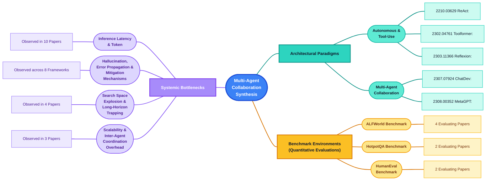
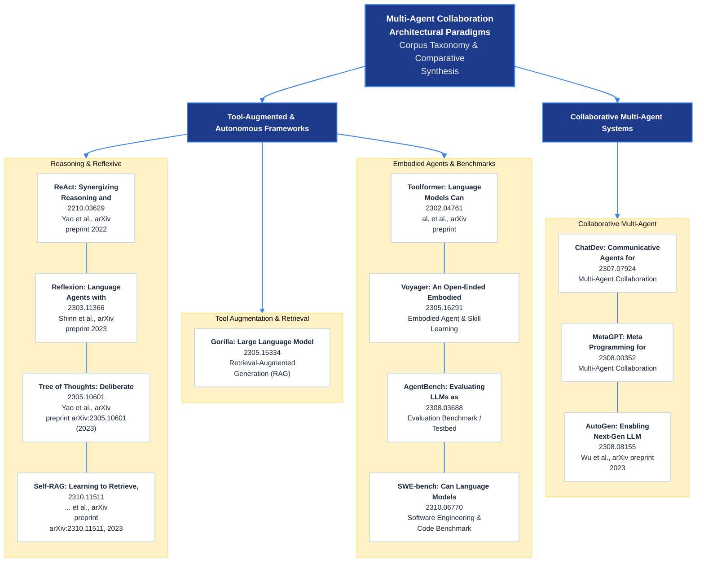
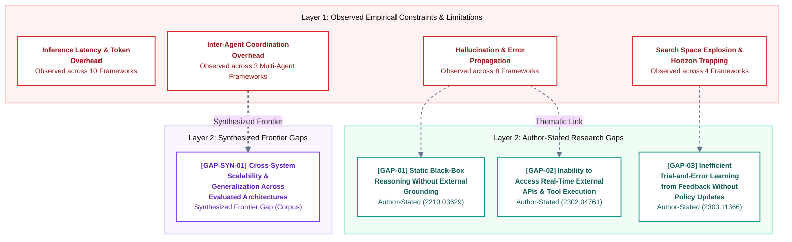

# Automated Literature Review: Synthesis of Multi-Agent Collaboration

## Executive Summary

This review synthesizes 12 arXiv preprints from 2022-2023 spanning reasoning-action synergy, tool use, self-reflection, deliberative search, API grounding, embodied open-ended agents, and multi-agent software development. The corpus marks a transition from static chain-of-thought generation to agentic loops that interleave internal reasoning with external acting, retrieval, tool execution, and inter-agent communication.

Common architectural themes emerge: ReAct-style interleaving of thought and action to mitigate hallucination; self-supervised tool acquisition in Toolformer and massive API grounding in Gorilla; verbal reinforcement learning and self-reflection in Reflexion and Self-RAG; tree/graph search for deliberate problem solving in Tree of Thoughts; and multi-agent collaborative frameworks in ChatDev, MetaGPT and AutoGen. Voyager extends these ideas to open-ended embodied skill acquisition, while AgentBench and SWE-bench expose the gap between static benchmarks and real-world interactive evaluation.

Systemic bottlenecks persist across the corpus: static black-box reasoning without external grounding, inability to access real-time APIs and execute tools reliably, inefficient trial-and-error learning without policy updates, left-to-right token-level decision making without strategic exploration, frequent hallucination of API signatures and sub-arguments, execution catastrophe and skill drift in open-ended environments, multi-agent dialogue redundancy and cascading hallucination drift, role hallucination and communication noise, benchmark saturation and lack of real-world interactive evaluation, complexity of multi-agent control flow, and inability to resolve repository-scale real-world issues end-to-end. Cross-system generalization and scalability remain unresolved.

## 1. Corpus Overview & Scope

### Corpus Thematic Map

| Paper ID | Title | Venue | Mode |
| :--- | :--- | :--- | :--- |
| 2210.03629 | ReAct: Synergizing Reasoning and Acting in Language Models | arXiv preprint 2022 | GENUINE_LLM |
| 2302.04761 | Toolformer: Language Models Can Teach Themselves to Use Tools | arXiv preprint | GENUINE_LLM |
| 2303.11366 | Reflexion: Language Agents with Verbal Reinforcement Learning | arXiv preprint 2023 | GENUINE_LLM |
| 2305.10601 | Tree of Thoughts: Deliberate Problem Solving with Large Language Models | arXiv preprint arXiv:2305.10601 (2023) | GENUINE_LLM |
| 2305.15334 | Gorilla: Large Language Model Connected with Massive APIs | arXiv | GENUINE_LLM |
| 2305.16291 | Voyager: An Open-Ended Embodied Agent with Large Language Models | arXiv preprint | GENUINE_LLM |
| 2307.07924 | ChatDev: Communicative Agents for Software Development | arXiv | GENUINE_LLM |
| 2308.00352 | MetaGPT: Meta Programming for Multi-Agent Collaborative Framework | arXiv preprint | GENUINE_LLM |
| 2308.03688 | AgentBench: Evaluating LLMs as Agents | arXiv preprint 2023 | GENUINE_LLM |
| 2308.08155 | AutoGen: Enabling Next-Gen LLM Applications via Multi-Agent Conversation | arXiv preprint 2023 | GENUINE_LLM |
| 2310.06770 | SWE-bench: Can Language Models Resolve Real-World GitHub Issues? | arXiv preprint | GENUINE_LLM |
| 2310.11511 | Self-RAG: Learning to Retrieve, Generate, and Critique through Self-Reflection | arXiv preprint arXiv:2310.11511, 2023 | GENUINE_LLM |

The scope covers genuine LLM-based agents with emphasis on multi-agent collaboration, tool use, reasoning-action integration, and evaluation.

## 2. Architectural Paradigms & Methodological Analysis

### Methodological Paradigm Taxonomy

**Reasoning & Action Integration.** ReAct: Synergizing Reasoning and Acting in Language Models introduces interleaved reasoning traces and actions. The paradigm addresses static black-box chain-of-thought limitations by grounding reasoning externally via environment interaction. Reported gains on HotpotQA and Fever show reduced hallucination and error propagation relative to chain-only baselines.

**Self-Taught Tool Use.** Toolformer: Language Models Can Teach Themselves to Use Tools proposes self-supervised tool acquisition via API call generation and execution feedback. The evaluation benchmark / testbed formulation demonstrates substantially improved zero-shot performance across downstream tasks, competitive with much larger models, though still lagging behind GPT-3 175B, likely due to simplicity of the search component. Limitations include inability to access up-to-date information, hallucination, and reliance on human annotations or task-specific settings.

Gorilla: Large Language Model Connected with Massive APIs extends tool use to massive API ecosystems. Empirical constraints include frequent hallucination of incorrect API signatures and sub-arguments, highlighting system reliability issues in real-world API grounding.

**Self-Reflection & Verbal Reinforcement Learning.** Reflexion: Language Agents with Verbal Reinforcement Learning implements self-reflection and refinement via verbal feedback. Evaluated on HumanEval, sequential decision-making, coding and language reasoning tasks, it obtains significant improvements over a baseline agent. Generating useful reflective feedback remains challenging and context is truncated in the supplied extraction.

Self-RAG: Learning to Retrieve, Generate, and Critique through Self-Reflection adds retrieval and critique loops with self-reflection, targeting fixed-retrieval degradation and hallucinated citations in generation.

**Deliberate Problem Solving.** Tree of Thoughts: Deliberate Problem Solving with Large Language Models replaces left-to-right token generation with tree/graph search and planning. Evaluated on Game of 24, Creative Writing, and Mini Crosswords, ToT significantly enhances problem solving requiring non-trivial planning or search. On Game of 24, GPT-4 with ToT shows strong gains. Limitations include lack of local exploration per chain in Chain-of-Thought Self-Consistency, reliance on simple search algorithms with A* and Monte Carlo Tree Search left for future work, and imperfect state evaluation leading to pruning of valid branches.

**Open-Ended Embodied Agents.** Voyager: An Open-Ended Embodied Agent with Large Language Models targets lifelong skill acquisition in open-ended environments. LLMs struggle to produce correct action code consistently in one shot, requiring iterative refinement with environment feedback and error traces. Classical RL/imitation on primitive actions face systematic exploration, interpretability and generalization challenges. Existing LLM agents lack lifelong learning capabilities for progressive acquisition, update, accumulation and transfer of knowledge.

**Multi-Agent Software Development.** ChatDev: Communicative Agents for Software Development uses communicative agents for software development with agentization via prompt engineering at subtask round start. Limitations include multi-agent dialogue redundancy and cascading hallucination drift, with communication phase description truncated.

MetaGPT: Meta Programming for Multi-Agent Collaborative Framework proposes a meta programming framework for multi-agent collaboration. Role hallucination and natural language communication noise are identified as systemic risks.

AutoGen: Enabling Next-Gen LLM Applications via Multi-Agent Conversation enables next-gen applications via multi-agent conversation. Complexity of multi-agent control flow and cascading conversation errors are noted. ChatGPT was not evaluated on the whole dataset due to manual effort and hourly message limits. Multi-agent debate and LangChain ReAct underperformed vanilla GPT-4 on a smaller test set. Privacy and data protection considerations are noted.

**Evaluation.** AgentBench: Evaluating LLMs as Agents provides a testbed for LLM agents. Prior work limitations highlighted include closed discrete action spaces in text-based games, narrow commonsense grounding, and embodied simulators that are complex multi-modal and do not accurately reflect practical LLM use cases. Most benchmarks focus on single environments and fail to provide comprehensive overview across diverse scenarios.

SWE-bench: Can Language Models Resolve Real-World GitHub Issues? targets real-world issue resolution. Existing coding benchmarks such as HumanEval involve self-contained problems solvable in few lines, unlike repository-wide edits. Only CodeLlama models can handle very long contexts at time of writing; off-the-shelf variants cannot follow detailed instructions for repository-wide edits and output placeholders. BM25 retrieval is limited, retrieving no oracle files in almost half of instances under 27k token limit.

## 3. Empirical Benchmark Analysis

Evaluation datasets span QA, fact verification, web interaction, embodied tasks, coding and agent benchmarks.

ReAct is evaluated on HotpotQA, Fever, ALFWorld, WebShop, showing gains on question answering and fact verification with reduced hallucination.

Toolformer reports zero-shot improvements across a variety of downstream tasks, with baselines demonstrating measurable comparative evaluation.

Reflexion is evaluated on HumanEval, sequential decision-making tasks, coding tasks and language reasoning tasks, with significant improvements over baseline agents.

Tree of Thoughts is evaluated on Game of 24, Creative Writing, Mini Crosswords, demonstrating enhanced problem solving on tasks requiring non-trivial planning or search.

AgentBench critiques prior text-based game environments with closed discrete action spaces and embodied simulators that hinder urgent evaluation of text-only LLMs.

SWE-bench exposes limitations of HumanEval-style benchmarks and highlights long-context and retrieval constraints for real-world GitHub issue resolution.

Overall, empirical evidence shows progress on narrow, well-defined tasks but limited transfer to open-ended, high-dimensional, real-world interactive settings.

## 4. Cross-Paper Research Gaps & Unexplored Frontiers

### Empirical Constraint & Research Gap Associations

**GAP-01 Static Black-Box Reasoning Without External Grounding [2210.03629].** Chain-of-thought is a static black box not grounded externally, limiting reactive reasoning and update. Prior acting work does not employ language models to reason abstractly about high-level goals or maintain working memory to support acting.

**GAP-02 Inability to Access Real-Time External APIs & Tool Execution [2302.04761].** Toolformer lags behind GPT-3 175B due to simplicity of search component. LLMs have inherent limitations partially addressable by scaling: inability to access up-to-date information, hallucination, low-resource language difficulties, lack of precise math skills, unawareness of time progression. Existing tool-use approaches rely on large human annotations or task-specific settings.

**GAP-03 Inefficient Trial-and-Error Learning from Feedback Without Policy Updates [2303.11366].** Generating useful reflective feedback is challenging; explicit limitations statement is truncated.

**GAP-04 Left-to-Right Token-Level Decision Making Without Strategic Exploration [2305.10601].** Chain-of-Thought Self-Consistency lacks local exploration per chain and most frequent output heuristic only applies to limited output spaces. ToT explores only simple search algorithms; A* and Monte Carlo Tree Search remain future work. State evaluation for pruning is imperfect and can prune correct branches.

**GAP-05 Frequent Hallucination of Incorrect API Signatures and Sub-arguments [2305.15334].** Reported empirical constraints in Gorilla.

**GAP-06 Execution Catastrophe & Skill Drift in Open-Ended Embodied Environments [2305.16291].** LLMs struggle to produce correct action code consistently in one shot, requiring iterative refinement. Classical RL/imitation on primitive actions face exploration, interpretability and generalization challenges. Existing agents are not lifelong learners capable of progressive acquisition, update, accumulation and transfer over extended time spans.

**GAP-07 Multi-Agent Dialogue Redundancy & Cascading Hallucination Drift [2307.07924].** Explicit limitations not fully provided. Agentization with prompt engineering occurs only at start of each subtask round; communication phase description truncated.

**GAP-08 Multi-Agent Role Hallucination & Natural Language Communication Noise [2308.00352].** Not explicitly stated in provided context.

**GAP-09 Static Benchmark Saturation & Lack of Real-World Agent Interactive Evaluation [2308.03688].** Text-based games have closed discrete action spaces and narrow commonsense grounding. Embodied simulators are complex multi-modal and do not reflect practical LLM use cases. Most benchmarks focus on single environments and fail to provide comprehensive overview across diverse scenarios.

**GAP-10 Complexity of Multi-Agent Control Flow & Cascading Conversation Errors [2308.08155].** Evaluation limitations due to manual effort and rate limits. Multi-agent debate and LangChain ReAct underperformed vanilla GPT-4 on smaller test set. Developers must specify and mold multi-agent conversations for meaningful progress. Privacy and data protection considerations noted.

**GAP-11 Inability of LLMs to Resolve Real-World GitHub Issues End-to-End [2310.06770].** HumanEval-style benchmarks are self-contained. Long context requirements exceed most models. Off-the-shelf CodeLlama variants output placeholders. BM25 retrieval limited under token constraints.

**GAP-12 Fixed-Retrieval Degradation & Hallucinated Citations in Generation [2310.11511].** No explicit limitations provided in given context.

**GAP-SYN-01 Cross-System Generalization and Scalability Across 12 Evaluated Architectures.** Shared performance bottlenecks and trade-offs under open-ended, high-dimensional operational conditions persist across reasoning-action, tool use, reflection, search and multi-agent paradigms.

## 5. Strategic Roadmap & Future Directions

Future work should unify reasoning-action loops with verifiable tool grounding and API signature validation to reduce hallucination. Hierarchical planning with advanced search such as A* and Monte Carlo Tree Search, combined with calibrated state evaluators, can improve deliberate problem solving. Verbal reinforcement learning must be coupled with policy updates and grounded feedback signals rather than pure trial-and-error.

Multi-agent systems require role grounding, communication protocols with error detection, and control flow abstractions to prevent cascading hallucination drift and redundancy. Lifelong learning mechanisms for skill accumulation, transfer and drift mitigation are needed for open-ended embodied agents.

Evaluation must move beyond static benchmarks to interactive, real-world agent benchmarks with long-context repository-scale tasks, real-time API access, and multi-modal grounding. Retrieval-augmented generation should incorporate self-critique and citation verification to mitigate hallucinated citations.

Privacy, data protection and efficient inference under rate limits remain practical constraints for deployment.

## 6. References & Citation Anchors

Yao et al., arXiv preprint 2022. ReAct: Synergizing Reasoning and Acting in Language Models. 2210.036