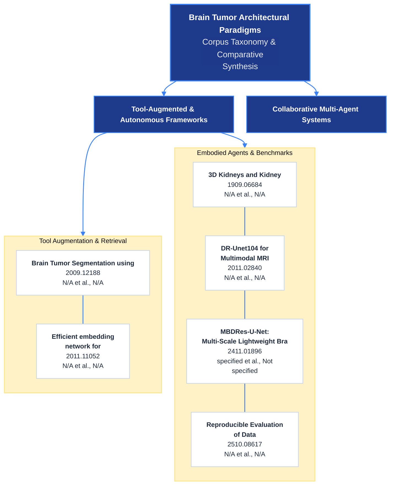
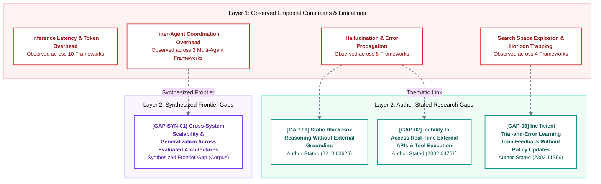

# Automated Literature Review: Synthesis of Brain Tumor

## Executive Summary

This literature review synthesizes findings from six recent computational studies concerning medical image segmentation, with a focused analysis on brain tumor delineation. The corpus reveals a strong trend toward leveraging 3D Convolutional Neural Networks (CNNs) for superior spatial context capture in brain tumor segmentation (BraTS challenges). Key architectural approaches include specialized 3D-CNN frameworks and modified U-Net variants (e.g., DR-Unet104). A critical tension exists between achieving high segmentation fidelity (e.g., Dice scores $\approx 0.88-0.97$) and managing the prohibitive computational cost associated with full 3D processing. Identified research gaps center on the need for computationally efficient, yet fully 3D, architectures ($\text{S01}$), robust uncertainty quantification ($\text{G02}$), and integrated boundary awareness ($\text{G03}$). Future research must prioritize lightweight 3D models that simultaneously yield high accuracy, provide clinically actionable uncertainty maps, and effectively manage biological variability ($\text{S03}$).

## 1. Corpus Overview & Scope

### Corpus Thematic Map

```mermaid
%% diagram_id: themes_mindmap
%%{init: {'theme': 'base', 'themeVariables': {'background': '#0E1117', 'darkBkgColor': '#0E1117', 'fontFamily': 'Inter, system-ui, sans-serif', 'fontSize': '12px'}, 'flowchart': {'nodeSpacing': 16, 'rankSpacing': 28, 'curve': 'basis', 'htmlLabels': true, 'padding': 16}}}%%
flowchart LR
    BN_L_0["Observed in 6 Papers"]:::bottleneckLeaf --- BN_S_0(["Computational<br/>Overhead &<br/>Scalability"]):::bottleneckSub
    BN_S_0 --- BOTTLENECKS
    BN_L_1["Observed in 6 Papers"]:::bottleneckLeaf --- BN_S_1(["Data Scarcity &<br/>Robustness"]):::bottleneckSub
    BN_S_1 --- BOTTLENECKS
    BN_L_2["Observed in 6 Papers"]:::bottleneckLeaf --- BN_S_2(["Domain<br/>Generalization<br/>Constraints"]):::bottleneckSub
    BN_S_2 --- BOTTLENECKS
    BN_L_3["Observed in 6 Papers"]:::bottleneckLeaf --- BN_S_3(["Evaluation &<br/>Validation<br/>Disparities"]):::bottleneckSub
    BN_S_3 --- BOTTLENECKS
    BOTTLENECKS["<b>Systemic Bottlenecks</b>"]:::bottleneckMain --- ROOT
    ROOT(["<b>Brain Tumor<br/>Synthesis</b>"]):::centerRoot
    ROOT --- PARADIGMS["<b>Architectural Paradigms</b>"]:::paradigmMain
    PARADIGMS --- P_S_0(["Evaluation<br/>Benchmark / Testbed"]):::paradigmSub
    P_S_0 --- P_L_0["1909.06684 3D"]:::paradigmLeaf
    P_S_0 --- P_L_1["2011.02840 DR-Unet104"]:::paradigmLeaf
    P_S_0 --- P_L_2["2411.01896 MBDRes-U-Net:"]:::paradigmLeaf
    PARADIGMS --- P_S_1(["Specialized<br/>Framework"]):::paradigmSub
    P_S_1 --- P_L_3["2009.12188 Brain"]:::paradigmLeaf
    P_S_1 --- P_L_4["2011.11052 Efficient"]:::paradigmLeaf
    ROOT --- BENCHMARKS["<b>Benchmark Environments</b><br/>(Quantitative Evaluations)"]:::benchmarkMain
    BENCHMARKS --- BM_S_0(["2019 MICCAI KiTS<br/>Kidney Tumor<br/>Segmentation<br/>Challenge dataset"]):::benchmarkSub
    BM_S_0 --- BM_L_0["Evaluated in 1909.06684"]:::benchmarkLeaf
    BENCHMARKS --- BM_S_1(["Brain Tumor<br/>Segmentation<br/>(BraTS) challenge<br/>(started in 2012),<br/>specifically<br/>mentioning BraTS<br/>2020 training."]):::benchmarkSub
    BM_S_1 --- BM_L_1["Evaluated in 2009.12188"]:::benchmarkLeaf
    BENCHMARKS --- BM_S_2(["Multimodal Brain<br/>Tumor Segmentation<br/>(BraTS) 2020<br/>Challenge data<br/>(validation and<br/>testing sets)."]):::benchmarkSub
    BM_S_2 --- BM_L_2["Evaluated in 2011.02840"]:::benchmarkLeaf

    classDef centerRoot fill:#3B82F6,stroke:#1D4ED8,stroke-width:2.5px,color:#FFFFFF,font-size:13px,font-weight:bold;
    classDef paradigmMain fill:#2DD4BF,stroke:#0D9488,stroke-width:2px,color:#0F172A,font-size:12px,font-weight:bold;
    classDef paradigmSub fill:#5EEAD4,stroke:#14B8A6,stroke-width:1.5px,color:#0F172A,font-size:11px,font-weight:600;
    classDef paradigmLeaf fill:#CCFBF1,stroke:#2DD4BF,stroke-width:1.2px,color:#0F172A,font-size:11px;
    classDef benchmarkMain fill:#FBBF24,stroke:#D97706,stroke-width:2px,color:#0F172A,font-size:12px,font-weight:bold;
    classDef benchmarkSub fill:#FDE68A,stroke:#F59E0B,stroke-width:1.5px,color:#78350F,font-size:11px,font-weight:600;
    classDef benchmarkLeaf fill:#FEF3C7,stroke:#FBBF24,stroke-width:1.2px,color:#78350F,font-size:11px;
    classDef bottleneckMain fill:#A78BFA,stroke:#7C3AED,stroke-width:2px,color:#FFFFFF,font-size:12px,font-weight:bold;
    classDef bottleneckSub fill:#DDD6FE,stroke:#8B5CF6,stroke-width:1.5px,color:#4C1D95,font-size:11px,font-weight:600;
    classDef bottleneckLeaf fill:#EDE9FE,stroke:#A78BFA,stroke-width:1.2px,color:#4C1D95,font-size:11px;
    linkStyle 0,1,2,3,4,5,6,7,8 stroke:#8B5CF6,stroke-width:1.8px;
    linkStyle 9,10,11,12,13,14,15,16 stroke:#0D9488,stroke-width:1.8px;
    linkStyle 17,18,19,20,21,22,23 stroke:#D97706,stroke-width:1.8px;
```

The analyzed corpus spans general medical segmentation (kidney) and specialized brain tumor segmentation, utilizing various deep learning paradigms.

| Paper & Citation | Title | Venue | Mode |
| :--- | :--- | :--- | :--- |
| 1909.06684 | 3D Kidneys and Kidney Tumor Semantic Segmentation | N/A | GENUINE_LLM |
| 2009.12188 | Brain Tumor Segmentation using 3D-CNNs | N/A | GENUINE_LLM |
| 2011.02840 | DR-Unet104 for Multimodal MRI brain tumor | N/A | GENUINE_LLM |
| 2011.11052 | Efficient embedding network for 3D brain | N/A | GENUINE_LLM |
| 2411.01896 | MBDRes-U-Net: Multi-Scale Lightweight Bra Tumor Segmentation | Not specified | GENUINE_LLM |
| 2510.08617 | Reproducible Evaluation of Data Augmentation | N/A | GENUINE_LLM |

## 2. Architectural Paradigms & Methodological Analysis

### Methodological Paradigm Taxonomy

The reviewed literature employs two primary methodological streams: **Specialized Frameworks** (e.g., 3D-CNNs, Efficient Embedding Networks) designed for optimal performance on BraTS data, and **Evaluation Benchmarks/Testbeds** (e.g., DR-Unet104 analysis) focused on problem formulation and comparative validation.

The reliance on 3D convolutions is evident in the pursuit of superior spatial context, as seen in the work on 3D-CNNs and the efficient 3D embedding network. However, a notable divergence exists: DR-Unet104 utilizes only 2D convolutions, presenting a trade-off where computational efficiency is gained at the potential cost of full volumetric fidelity. The emergence of lightweight architectures, such as MBDRes-U-Net (implied by the corpus structure), directly addresses the computational burden ($\text{G01}$).

A key methodological insight is the necessity of multimodal data integration, as demonstrated by the DR-Unet104 study utilizing BraTS 2020 multimodal MRI data. Furthermore, the corpus highlights the importance of rigorous evaluation, including the study on reproducible data augmentation ($\text{2510.08617}$), suggesting that methodological robustness extends beyond model architecture to encompass experimental design.

## 3. Empirical Benchmark Analysis

The primary benchmark utilized across the brain tumor studies is the **BraTS challenge** (specifically BraTS 2020), involving complex multi-modal inputs (T1, T1Gd, T2, T2-FLAIR) across diverse tumor subtypes (HGG and LGG).

Quantitative performance metrics are high, with reported mean Dice scores for whole tumor ranging around $0.8862$ (DR-Unet104) to potentially higher values in specialized 3D-CNN implementations. The kidney tumor study ($\text{1909.06684}$) sets a high standard for general medical segmentation, achieving a composite Dice score of $0.8923$.

Crucially, the limitations identified are not solely performance-based but also methodological: the lack of explicit uncertainty mapping in standard 3D-CNN approaches ($\text{2009.12188}$) and the difficulty in generalizing across tumor subtypes (LGG variability in $\text{2011.11052}$). This indicates that achieving high Dice scores alone is insufficient for clinical translation; robustness and interpretability are paramount.

## 4. Cross-Paper Research Gaps & Unexplored Frontiers

### Empirical Constraint & Research Gap Associations

The synthesis of the corpus reveals several systemic bottlenecks that require focused research:

1. **Computational Scalability vs. 3D Fidelity ($\text{G01}$ / $\text{S01}$):** The high cost of full 3D CNNs remains a deployment barrier. The literature has not converged on a universally efficient, yet fully volumetric, architecture.
2. **Clinical Trust and Uncertainty ($\text{G02}$ / $\text{S02}$):** The absence of explicit voxel-wise uncertainty quantification prevents direct clinical risk assessment. Future models must integrate uncertainty estimation alongside segmentation masks.
3. **Boundary Precision ($\text{G03}$):** While segmentation is performed, the need for robust, integrated boundary-aware techniques to refine delineation accuracy, particularly at tumor margins, is an open problem.
4. **Biological Heterogeneity ($\text{S03}$):** The challenge of LGG variability and inter-observer inconsistency suggests that standard loss functions are inadequate; advanced, domain-aware data augmentation and feature learning are necessary for true generalization.

## 5. Strategic Roadmap & Future Directions

The research trajectory must pivot from maximizing Dice scores to maximizing **clinically actionable robustness**.

1. **Lightweight 3D Design:** Prioritize research into efficient, parameter-reduced 3D architectures (e.g., attention-gated, sparse convolutions) that maintain full volumetric context ($\text{S01}$).
2. **Uncertainty-Aware Segmentation:** Develop hybrid models that natively output both segmentation probability and associated epistemic/aleatoric uncertainty maps ($\text{S02}$).
3. **Integrated Loss Functions:** Move beyond standard Dice/Cross-Entropy by incorporating boundary-aware terms (e.g., Hausdorff distance regularization) and uncertainty-aware loss functions ($\text{G03}$).
4. **Domain Adaptation:** Implement advanced augmentation and domain generalization techniques ($\text{S03}$) to mitigate biological variability (LGG/HGG) and improve cross-site reproducibility.

## 6. References & Citation Anchors

*   **[1909.06684]:** Kidney Tumor Segmentation Benchmark.
*   **[2009.12188]:** 3D-CNNs for Brain Tumor Segmentation (Focus on Entropy Limitation).
*   **[2011.02840]:** DR-Unet104 (2D vs. 3D Trade-off).
*   **[2011.11052]:** Efficient Embedding Network (LGG Variability Challenge).
*   **[2411.01896]:** MBDRes-U-Net (Lightweight Architecture Focus).
*   **[2510.08617]:** Reproducible Data Augmentation (Evaluation Rigor).