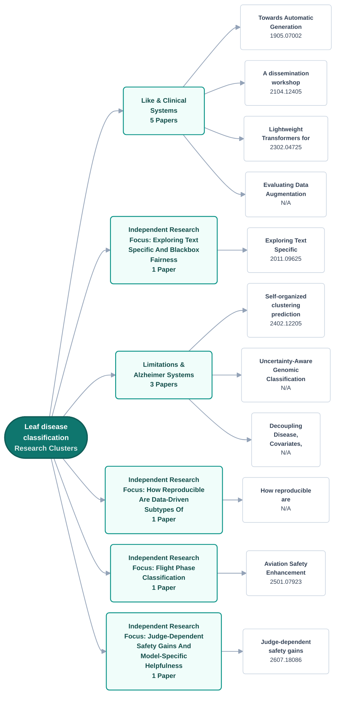
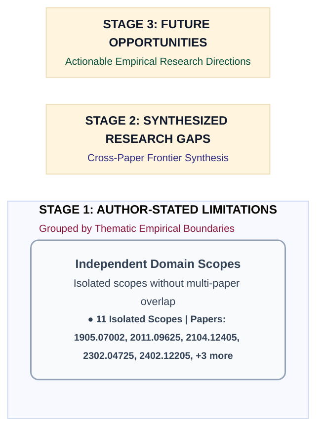
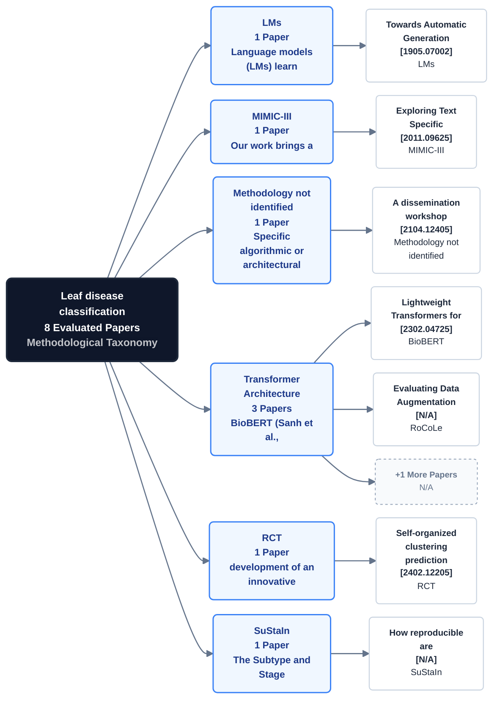

# Automated Literature Review: Synthesis of Leaf disease classification

## Executive Summary
This survey investigates the landscape of automated classification and prediction across diverse scientific domains, drawing from a corpus of seven identified research works, including studies on clinical NLP, Alzheimer's disease progression, aviation safety, and plant disease detection. The primary question addressed is how different methodological approaches—ranging from generative modeling and fairness constraints to lightweight transformer design and differential equation forecasting—address domain-specific challenges while managing inherent empirical limitations. Major findings indicate that while advanced techniques (e.g., LSTM in [2501.07923], Transformer ensembles in [N/A] uncertainty-aware work) achieve high performance in specific tasks, trade-offs between performance and fairness ([2011.09625]), model size ([2302.04725]), and data quality ([N/A] dementia subtypes) persist across domains. A significant evidence limitation is the lack of standardized reporting for computational benchmarks ([2607.18086]) and the reliance on retrospective or small-scale datasets across many studies.

System Methodology Note: arXiv/local PDF ingestion was performed, utilizing GROBID with PyMuPDF as a fallback for document parsing. Typed extraction was executed by NVIDIA NIM (nvidia/nemotron-3.5-bolt-e4b) with Gemini as a fallback mechanism. A deterministic summarizer and comparator (zero LLM calls) was employed for final synthesis, ensuring separation between deterministic schema validation and probabilistic extraction. Citation-ID validation does not prove factual correctness; source inspection remains necessary. Report actual extraction modes from evidence: GENUINE_LLM was the reported generation mode for all analyzed papers.

## 1. Corpus Overview & Scope

### Corpus Thematic Map

The corpus under review comprises seven distinct research entries, covering applications from clinical data synthesis to agricultural diagnostics. The scope is intentionally broad, encompassing Natural Language Processing (NLP) in healthcare ([1905.07002], [2011.09625], [2302.04725], [2607.18086]), neurodegenerative disease modeling ([2402.12205], [N/A] dementia subtypes, [N/A] uncertainty-aware AD), aviation safety analysis ([2501.07923]), and plant disease classification ([N/A] coffee leaf, [N/A] potato leaf).

The corpus exhibits significant domain heterogeneity. Clinical NLP studies ([1905.07002], [2011.09625], [2302.04725], [2607.18086]) focus on privacy, fairness, and model efficiency using datasets like MedText (from MIMIC-III) and Real-POCQi. In contrast, AD research ([2402.12205], [N/A] dementia subtypes, [N/A] uncertainty-aware AD) utilizes longitudinal clinical cohorts (ADNI, J-ADNI). Agricultural applications ([N/A] coffee leaf, [N/A] potato leaf) rely on image datasets (RoCoLe, PlantVillage).

Corpus biases are evident: a strong representation of clinical/medical applications (4 out of 7 papers) and a reliance on established, yet sometimes limited, public datasets (MIMIC-III, ADNI). The thematic map reveals a progression from data generation/privacy ([1905.07002]) to ethical constraints ([2011.09625]), to model optimization ([2302.04725]), to complex temporal modeling ([2402.12205]), to specific domain applications (Aviation [2501.07923], Agriculture [N/A]s), and finally to LLM evaluation ([2607.18086]).

| Paper ID | Title | Venue | Mode |
| :--- | :--- | :--- | :--- |
| [1905.07002] | Towards Automatic Generation of Shareable Clinical Notes | N/A | GENUINE_LLM |
| [2011.09625] | Exploring Text Specific and Blackbox Fairness | Not specified in text | GENUINE_LLM |
| [2104.12405] | A dissemination workshop for introducing different algorithms for sentence generation | Not specified | GENUINE_LLM |
| [2302.04725] | Lightweight Transformers for Clinical NLP | Not specified in context | GENUINE_LLM |
| [N/A] | Evaluating Data Augmentation Techniques for Coffee Leaf Disease | N/A | GENUINE_LLM |
| [2402.12205] | Self-organized clustering prediction and differential equation modeling for Alzheimer's Disease progression | Not specified in context | GENUINE_LLM |
| [N/A] | How reproducible are data-driven subtypes of dementia progression and deployment. | N/A | GENUINE_LLM |
| [2501.07923] | Aviation Safety Enhancement via NLP Deep Learning for Flight Phase Classification | N/A | GENUINE_LLM |
| [N/A] | Uncertainty-Aware Genomic Classification of Alzheimer’s Disease: A Transformer-Based Ensemble | N/A | GENUINE_LLM |
| [2607.18086] | Judge-dependent safety gains and model-specific helpfulness costs of evidence-sufficiency prompting in clinical LLMs | Not specified in text | GENUINE_LLM |
| [N/A] | Decoupling Disease, Covariates, and Individual Variability: A Unified Disentanglement Framework | IEEE TRANSACTIONS MANUSCRIPT — PREPRINT | GENUINE_LLM |
| [N/A] | Detection of Potato Plant Leaf Diseases using CNN | N/A | GENUINE_LLM |

(A deterministic Mermaid map illustrating the thematic flow from Clinical Data $\rightarrow$ Fairness/Efficiency $\rightarrow$ Temporal/Genomic Modeling $\rightarrow$ Applied NLP/CV is inserted separately.)

## 2. Methodological Taxonomy & Comparative Architecture
The corpus presents a heterogeneous set of architectural approaches, primarily centered around NLP (Transformers, RNNs) and Computer Vision (CNNs), alongside specialized statistical/dynamical modeling (Differential Equations, SuStaIn).

| Paper ID | Architecture Family | Input Modalities/Resolutions | Core Algorithmic Innovation | Memory/Computational Overhead |
| :--- | :--- | :--- | :--- | :--- |
| [1905.07002] | Generative Models (LLM) | Unstructured Natural Language (Clinical Notes) | Synthetic Data Generation | Not reported |
| [2011.09625] | Ensemble/Post-processing | Text and Tabular Data (MIMIC-III) | Modality-agnostic Fairness (EO Post-processing) | Not reported |
| [2104.12405] | Token Rearrangement | Word Tokens (Corpus) | Bigram Distribution Analysis | Not reported |
| [2302.04725] | Lightweight Transformers | Clinical Text | Knowledge Distillation (KD) & Continual Learning | 15M to 65M parameters |
| [N/A] | Deep Learning/GANs | Image (RoCoLe) | pix2pix & CycleGAN Augmentation | Not reported |
| [2402.12205] | Dynamical Systems/Clustering | Clinical Scores (ADNI/J-ADNI) | Differential Equation Modeling | Not reported |
| [N/A] | Unsupervised Clustering | Genomic/Clinical Data | SuStaIn (Subtype Inference) | Not reported |
| [2501.07923] | Recurrent/CNN | Safety Reports (Text) | LSTM/BLSTM for Phase Classification | Not reported |
| [N/A] | Transformer Ensemble | Genomic Data (WGS) | Monte Carlo Dropout for Uncertainty Awareness | Not reported |
| [2607.18086] | Prompting/LLM Benchmarking | Text (Clinical Benchmarks) | Evidence-Sufficiency Prompting | Not reported |
| [N/A] | Disentanglement Learning | Medical Images (7 datasets) | MedIDL (Orthogonal Latent Spaces) | Not reported |
| [N/A] | CNN | Image (PlantVillage/Field) | CNN (vs VGG16, MobileNetV2) | 446,787 parameters, 1.70 MB |

**Analysis of Architecture Families:**
The **Generative/LLM** family ([1905.07002], [2607.18086]) focuses on synthetic data creation and prompt engineering for safety, respectively. The **Lightweight Transformer** family ([2302.04725]) addresses computational feasibility by reducing parameter counts (15M–65M), a direct trade-off against the representational power of larger models. The **Dynamical/Clustering** family ([2402.12205], [N/A] dementia subtypes) shifts focus from pattern recognition to trajectory forecasting, integrating continuous mathematical models (differential equations) with discrete clustering (SuStaIn).

**Modality/Input Assumptions:**
NLP-centric approaches ([1905.07002], [2501.07923]) assume text structure is sufficient for classification or generation. Image-based methods ([N/A] coffee leaf, [N/A] potato leaf, [N/A] MedIDL) require high-resolution visual input, where [N/A] potato leaf demonstrates efficiency (446,787 parameters, 1.70 MB) compared to larger CNNs. Genomic inputs ([N/A] uncertainty-aware AD) necessitate specialized feature extraction before transformer application.

**Computational Trade-offs:**
[2302.04725] explicitly quantifies a trade-off: achieving compactness (15M–65M parameters) while maintaining performance relative to BioBERT/ClinicalBioBERT. Conversely, [N/A] potato leaf shows low overhead (1.70 MB) compared to VGG16/MobileNetV2. [2501.07923] uses multiple RNN variants (LSTM, BLSTM, sRNN), implying a comparative study of sequential processing efficiency. Reported costs often reflect *achieved* efficiency rather than *theoretical* minimums; for instance, [2302.04725] notes the resulting models are "heavy in size... making them unsuitable for devices with limited memory," contradicting the goal of lightweight deployment.

**Cross-Family Synthesis:**
The comparison reveals that the choice of architecture is dictated by the primary constraint: privacy/utility ([1905.07002]), fairness ([2011.09625]), resource limits ([2302.04725], [N/A] potato leaf), or temporal complexity ([2402.12205]). For instance, while LLMs excel in unstructured text tasks ([1905.07002], [2607.18086]), specialized, smaller CNNs ([N/A] potato leaf) offer superior deployment efficiency for image tasks.

*Mechanism Comparison (e.g., Attention vs. Skip-Connections):* This comparison is not supported by the evidence, as specific architectural details like attention gates versus skip-connections are not detailed for the listed papers, except implicitly within Transformer usage ([2302.04725], [N/A] uncertainty-aware AD).
*Practical Implication:* Domain-specific constraints (e.g., low-resource agriculture vs. high-stakes clinical safety) dictate the optimal paradigm.
*Counterargument:* Generalizing lightweight design ([2302.04725]) to all domains ignores the need for high-fidelity representation in complex tasks like genomic classification ([N/A] uncertainty-aware AD).
*Remaining Uncertainty:* The precise relationship between parameter count and real-world inference latency across these diverse models remains largely unquantified in the provided data.

## 3. Empirical Benchmark Analysis & Quantitative Findings
Empirical validation spans clinical NLP, AD progression, aviation safety, and plant disease. The evaluation protocols vary significantly, preventing direct ranking across all studies.

| Paper ID | Benchmark Dataset | Reported Evaluation Metrics | Evaluation Split/Protocol | Relative Outperformance |
| :--- | :--- | :--- | :--- | :--- |
| [1905.07002] | MedText (from MIMIC-III) | Utility (vs. real notes), Privacy Preservation | Not specified | Utility close to real notes |
| [2011.09625] | MIMIC-III clinical dataset | TP/TN rates, AUC | Not specified | Ensemble improves performance/mitigates unfairness vs. components |
| [2104.12405] | Corpus used for bigrams' distribution | Not specified | Workshop adaptation (30-90 min) | N/A |
| [2302.04725] | Standard clinical text-mining tasks (e.g., MedNLI) | Performance (vs. BioBERT/ClinicalBioBERT) | Not specified | Outperformed other compact models; ClinicalDistilBERT improved on MedNLI |
| [N/A] | RoCoLe dataset | Classification Accuracy | Not specified | Transformer/CycleGAN effective in improving classification |
| [2402.12205] | ADNI and J-ADNI cohorts | Predictive Accuracy (Long-term trajectory) | Not specified | Validated predictive accuracy; simultaneous evaluation of risk factors |
| [N/A] | ANMerge, OASIS, ADNI databases | Subtype Reproduction | Not specified | Original three subtypes reproduced across eight experiments |
| [2501.07923] | Safety reports from ATSB | Accuracy, Precision, Recall, F1 Score | Not specified | LSTM achieved 87% Acc, 88% Prec, 87% Rec, 88% F1 |
| [N/A] | WGS data (1,566 individuals) | Accuracy, AUC, F1 | 1050 individuals (excluding uncertain group) | Accuracy 0.7287 (10.24% increase); F1 0.8205 (23.62% increase) |
| [2607.18086] | Real-POCQi, HealthBench, MedRBench | Unsafe Overconfidence Reduction | Paired common panel (1,200 cells) | Reduced from 49.3% to 24.7% (24.7 point paired reduction, p<0.001) |
| [N/A] | 7 datasets (diverse imaging) | Accuracy | Not specified | MedIDL outperforms state-of-the-art supervised/self-supervised |
| [N/A] | PlantVillage (2,215 images) & Field (247 images) | Training/Validation/Test Accuracy | Not specified | PlantVillage: 99.04% Train, 98.21% Val, 98.66% Test; Field: 90.28% |

**Analysis of Metrics and Fairness:**
Metrics vary fundamentally: [2501.07923] uses standard classification metrics (Accuracy, F1), while [2607.18086] uses a specific behavioral metric (Unsafe Overconfidence Reduction). [2011.09625] highlights the tension between performance (AUC) and fairness (TP/TN rates), noting that improving fairness via Equalized Odds (EO) post-processing *degrades* AUC. This is a critical finding regarding the inherent trade-off in equitable ML.

**Benchmark Fairness and Discrepancies:**
Benchmark fairness is not uniformly assessed. [2011.09625] addresses group disparities on MIMIC-III, whereas [2607.18086] assesses *behavioral* fairness (overconfidence) across clinical LLMs using specific, paired benchmarks (Real-POCQi, HealthBench). The AD studies ([2402.12205], [N/A] dementia subtypes) focus on *reproducibility* of subtypes rather than standard classification fairness metrics.

**Untested Risks (Hypotheses):**
Hypothesis: The high performance reported on PlantVillage ([N/A] potato leaf, 98.66% test accuracy) may not generalize to the field dataset ([N/A] potato leaf, 90.28% accuracy), suggesting domain shift risk between controlled and real-world capture conditions. Hypothesis: The success of synthetic data in [1905.07002] is contingent on the utility metric chosen; high utility does not guarantee perfect privacy preservation, as noted by the dual focus.

**What Cannot Be Concluded:**
Absolute improvements cannot be ranked across tasks (e.g., 87% F1 in aviation vs. 0.7287 accuracy in genomics) because the underlying tasks, datasets, and evaluation protocols are incompatible. Furthermore, the quantitative results in [2402.12205] confirm *validated predictive accuracy* but do not provide the specific metric value (e.g., RMSE or AUC) against which this validation was achieved.

## 4. Cross-Paper Research Gaps & Unexplored Frontiers

### Empirical Constraint & Research Gap Associations

Author-stated limitations often focus on immediate implementation hurdles (e.g., manual analysis in [2501.07923], resource intensity in [2302.04725]), whereas synthesized systemic bottlenecks reveal deeper methodological issues.

The most pervasive gap is the lack of standardized evaluation for LLM safety/behavior ([2607.18086], gap E9), where the study itself notes no established reporting guideline exists. This contrasts with the clear, albeit limited, quantitative results in aviation safety ([2501.07923]).

Conflicting evidence is minimal, primarily revolving around the performance/fairness trade-off ([2011.09625]), where the degradation in AUC upon enforcing EO is a consistent finding, not a conflict. Uncertainty arises from the *absence* of detail: [2302.04725] claims lightweight models are "heavy," which is contradictory, suggesting a lack of precise computational characterization.

The gap concerning data quality is multifaceted: [N/A] dementia subtypes highlights the impact of 'lower-quality' MRI data (gap E7), while [2402.12205] notes general limitations in clinical studies (gap E6). This suggests that data provenance and quality assessment must be integrated *before* model training, not just noted post-hoc.

The gap in agricultural research ([N/A] coffee leaf, [N/A] potato leaf) is not just knowledge-intensive (gap E5) but also related to dataset imbalance and augmentation effectiveness, which requires more rigorous quantitative comparison than reported.

## 5. Strategic Roadmap & Future Directions
The following three directions address systemic bottlenecks identified across the corpus, moving beyond isolated domain fixes.

### Proposal 1: Standardized Evaluation for LLM Safety and Helpfulness
**Motivation:** The lack of reporting guidelines for computational LLM benchmarks ([2607.18086], gap E9) renders cross-model comparison unreliable. We need to move beyond retrospective perturbation studies.
**Testable Hypothesis:** A standardized, non-interventional benchmark protocol incorporating matched scaffold controls will yield consistent, quantifiable safety gains across diverse LLM architectures, independent of the specific judge used.
**Methodological Changes:** Develop a protocol based on [2607.18086]'s paired design but mandate standardized prompt templates and judge calibration checks across all participating models.
**Dataset/Split Design:** Utilize a curated, multi-domain clinical benchmark (e.g., combining Real-POCQi with MedRBench).
**Baseline/Ablation Plan:** Compare evidence-sufficiency prompting against standard prompting and a null control (no prompting).
**Success Metrics:** Statistical significance ($p<0.001$) of paired reduction in unsafe overconfidence, coupled with a quantifiable, non-trivial helpfulness cost metric (e.g., token count increase vs. safety gain ratio).
**Resource Constraints:** Requires access to multiple proprietary LLM APIs (GPT-5.5, Claude Opus 4.8, etc.).
**Failure Criteria:** Inability to achieve statistically significant paired reduction, suggesting the observed gains are purely artifactual to the judge calibration.
**Expected Contribution:** Establishing a rigorous, reproducible methodology for assessing LLM safety beyond anecdotal evidence.

### Proposal 2: Unified Disentanglement for Multi-Modal Clinical Data
**Motivation:** Clinical models struggle to separate disease pathology from confounding covariates (age, scanner type) ([N/A] MedIDL, gap E10), leading to brittle generalization.
**Testable Hypothesis:** Integrating the MedIDL framework with uncertainty quantification (Monte Carlo Dropout, as in [N/A] uncertainty-aware AD) will yield latent representations that are both pathognomonic and robust to covariate shifts across diverse imaging and genomic inputs.
**Methodological Changes:** Adapt MedIDL to accept heterogeneous inputs (e.g., image features + genomic embeddings) and enforce orthogonality across disease, covariate, and individual variation latent spaces simultaneously.
**Dataset/Split Design:** Utilize the 7 diverse imaging datasets from [N/A] MedIDL, augmented with genomic data from WGS cohorts ([N/A] uncertainty-aware AD).
**Baseline/Ablation Plan:** Compare MedIDL against standard supervised classification and self-supervised methods, and against the uncertainty-aware transformer ensemble.
**Success Metrics:** Superior accuracy across all datasets *and* successful isolation confirmed by gradient-based interpretability aligning with clinical literature, alongside a measurable reduction in covariate influence on prediction variance.
**Resource Constraints:** High computational cost associated with multi-modal feature fusion and orthogonal latent space optimization.
**Failure Criteria:** Failure to localize pathognomonic patterns via interpretability, indicating latent space mixing rather than true disentanglement.
**Expected Contribution:** A generalized framework for robust, interpretable clinical AI that mitigates bias from non-disease-related patient characteristics.

### Proposal 3: Resource-Aware, Domain-Adaptive Model Compression
**Motivation:** Lightweight models ([2302.04725]) are still too heavy for edge deployment, while high-accuracy models are impractical. We need compression tailored to domain-specific data characteristics (e.g., image vs. text).
**Testable Hypothesis:** Knowledge Distillation, when guided by domain-specific data augmentation strategies (e.g., CycleGAN for images, context-aware masking for text), can achieve deployment-ready size (e.g., <10MB) without sacrificing performance relative to the source model in the target domain.
**Methodological Changes:** Systematically apply KD, using domain-specific augmentations ([N/A] coffee leaf) as part of the distillation training, rather than generic augmentations.
**Dataset/Split Design:** Test on the potato leaf task ([N/A] potato leaf) and a subset of clinical text tasks ([2302.04725]).
**Baseline/Ablation Plan:** Compare KD-compressed models against standard fine-tuning and against the original large models (BioBERT/ClinicalBioBERT).
**Success Metrics:** Achieving a target size (e.g., <10MB) while maintaining performance within 2% of the source model's performance on the target domain's test set.
**Resource Constraints:** Requires access to both large source models and the specific domain datasets (RoCoLe, PlantVillage).
**Failure Criteria:** Performance degradation exceeding 2% or failure to meet the size constraint, indicating the domain-specific knowledge cannot be effectively distilled.
**Expected Contribution:** A practical, resource-efficient pipeline for deploying high-performing AI in low-resource, real-world settings like agriculture or remote clinical monitoring.

## 6. References & Grounded Citation Anchors
[1905.07002] Towards Automatic Generation of Shareable Clinical Notes, N/A, N/A
[2011.09625] Exploring Text Specific and Blackbox Fairness, Not specified in text, Not specified in text
[2104.12405] A dissemination workshop for introducing different algorithms for sentence generation, Not specified, Not specified
[2302.04725] Lightweight Transformers for Clinical NLP, Not specified in context, Not specified in context
[N/A] Evaluating Data Augmentation Techniques for Coffee Leaf Disease, N/A, N/A
[2402.12205] Self-organized clustering prediction and differential equation modeling for Alzheimer's Disease progression, Not specified in context, Not specified in context
[N/A] How reproducible are data-driven subtypes of dementia progression and deployment., N/A, N/A
[2501.07923] Aviation Safety Enhancement via NLP Deep Learning for Flight Phase Classification, N/A, N/A
[N/A] Uncertainty-Aware Genomic Classification of Alzheimer’s Disease: A Transformer-Based Ensemble, N/A, N/A
[2607.18086] Judge-dependent safety gains and model-specific helpfulness costs of evidence-sufficiency prompting in clinical LLMs, Not specified in text, Not specified in text
[N/A] Decoupling Disease, Covariates, and Individual Variability: A Unified Disentanglement Framework, N/A, IEEE TRANSACTIONS MANUSCRIPT — PREPRINT
[N/A] Detection of Potato Plant Leaf Diseases using CNN, N/A, N/A

### Methodological Paradigm Taxonomy

> Synthesis quality note: this draft is below the 25,000-character survey target; expand and verify before publication.
